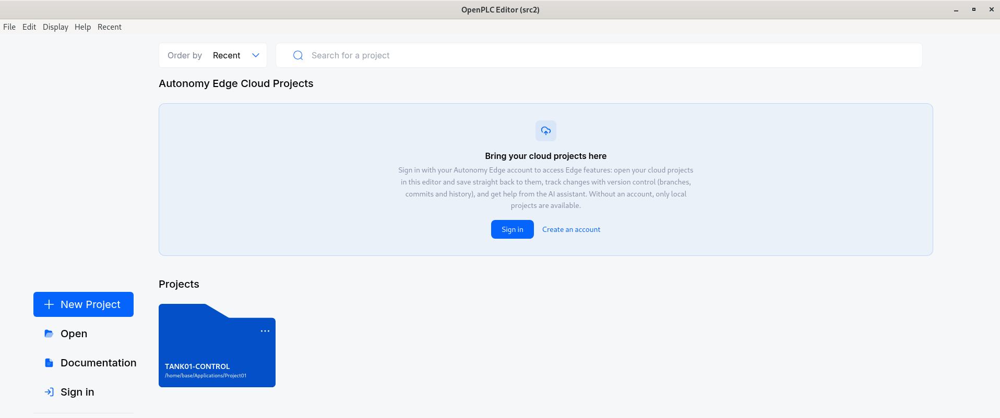
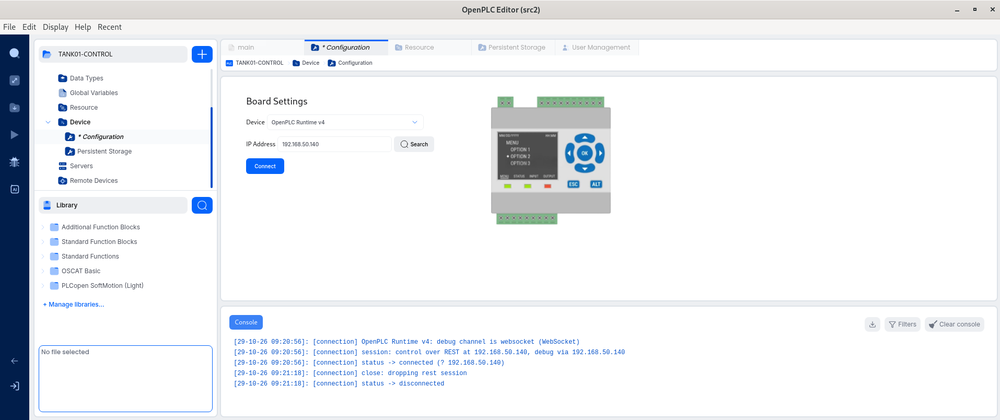
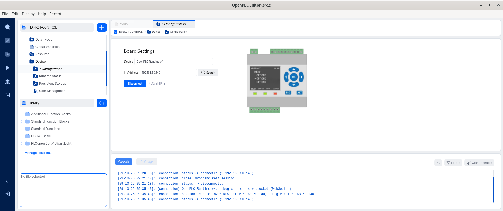
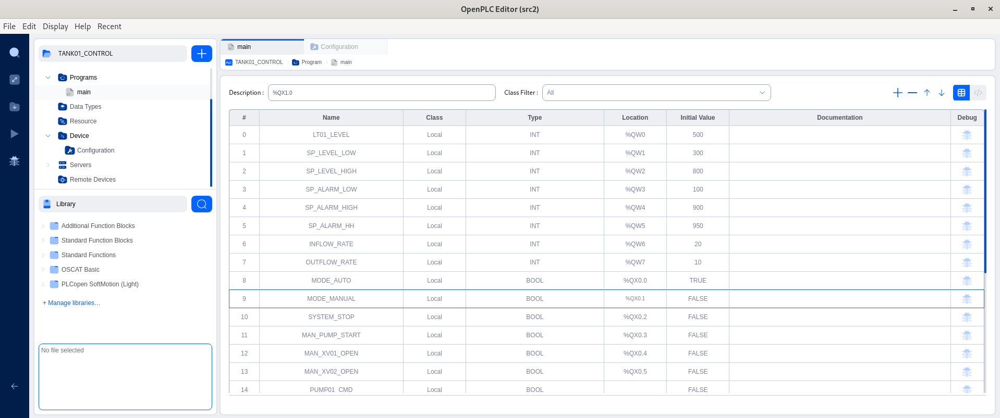
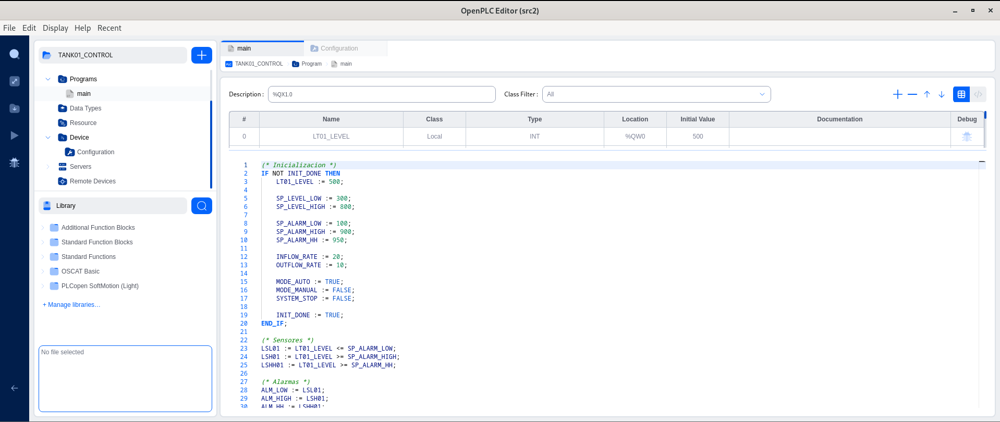
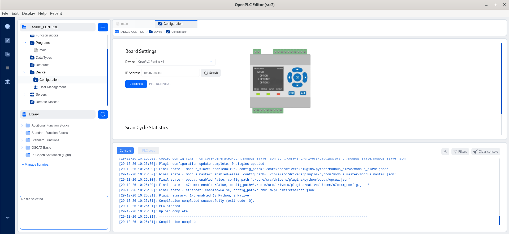
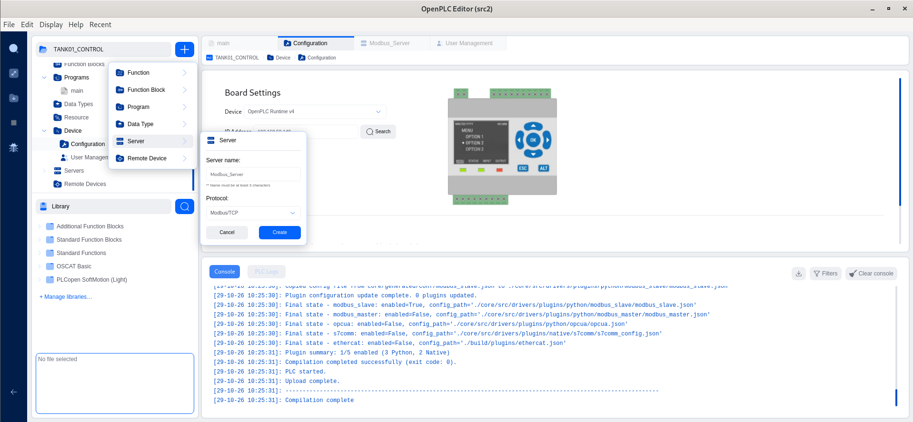
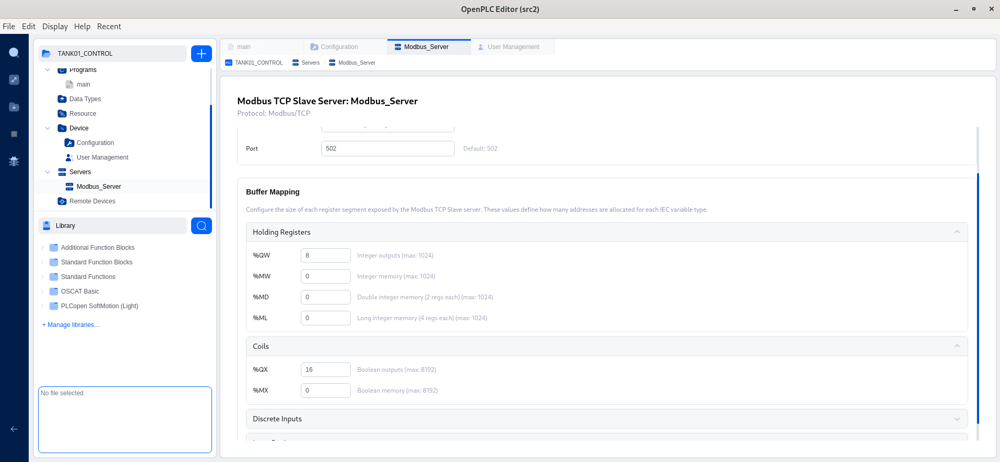
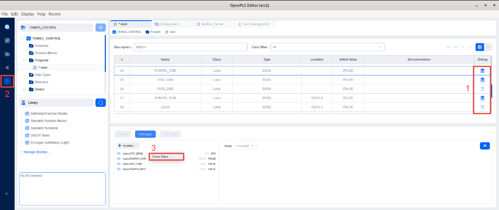
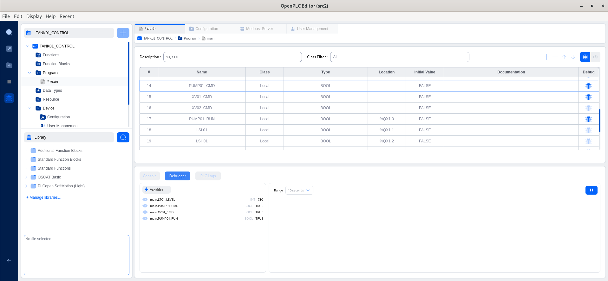

# ENG01 — OpenPLC Editor

## 1. Overview

**ENG01** is the Engineering Workstation responsible for developing, compiling, debugging, and deploying the control logic of the simulated industrial process in **OT-Splunk-Lab**, using **OpenPLC Editor** as the programming environment.

The system runs **Debian 12** as its base operating system and uses OpenPLC Editor as the engineering tool for creating and managing programs that will subsequently be executed on **OpenPLC Runtime (PLC01)**.

### System Architecture

```text
ENG01
└── Debian 12
    └── OpenPLC Editor
        └── PLC01 — OpenPLC Runtime
```

OpenPLC Editor enables the development of control programs using languages defined by IEC 61131-3, the configuration of industrial communications, and the deployment of programs to the simulated controller.

## 2. System Specifications

### 2.1. Virtual Machine Resources

| Parameter | Configuration |
|---|---|
| Hostname | `ENG01` |
| Operating System | Debian GNU/Linux 12 (bookworm) |
| CPU | 2 vCPU |
| RAM | 2 GB |
| Storage | 20 GB |

## 3. Network Configuration

### 3.1. IPv4 Addressing

| Parameter | Value |
|---|---|
| IPv4 Address | `192.168.50.40` |
| Subnet Mask | `255.255.255.0` |
| Prefix | `/24` |

### 3.2. Required Communications

| Destination | Port | Protocol | Purpose |
|---|---|---|---|
| PLC01 | 8443 | TCP/HTTPS | Connection to OpenPLC Runtime |
| PLC01 | 502 | TCP/Modbus | Controller Modbus service |

The IP address and network parameters correspond to the environment used during laboratory development and must be adapted when reproducing the infrastructure in another environment.

## 4. Prerequisites

Before starting the deployment, ensure the following requirements are met:

- A virtual machine running Debian 12.
- A user account with `sudo` privileges.
- Network connectivity and Internet access.
- Hardware resources specified in Section 2.
- Access to the OpenPLC Editor AppImage distribution.
- OpenPLC Runtime deployed on PLC01 for subsequent connection and project deployment.

## 5. Installation & Configuration

### 5.1. Operating System Preparation

Update the package repositories and upgrade installed packages:

```bash
sudo apt update
sudo apt full-upgrade -y
```

Install the required dependencies:

```bash
sudo apt install -y \
  curl \
  ca-certificates \
  libfuse2
```

### 5.2. OpenPLC Editor Installation

#### 5.2.1. Download OpenPLC Editor

Download the **AppImage** version of OpenPLC Editor from the official website:

[OpenPLC — Official Website](https://autonomylogic.com/products/openplc)

#### 5.2.2. Prepare the Installation Directory

Create the directory for storing the application:

```bash
mkdir -p ~/Applications
```

Move the downloaded AppImage file:

```bash
mv ~/Downloads/OpenPLC*.AppImage ~/Applications/
```

Navigate to the directory:

```bash
cd ~/Applications
```

#### 5.2.3. Configure Execution Permissions

Grant execution permissions to the application:

```bash
chmod +x OpenPLC*.AppImage
```

#### 5.2.4. Launch OpenPLC Editor

Start the application:

```bash
./OpenPLC*.AppImage
```

Once the application starts successfully, the OpenPLC Editor main interface will be displayed.


### 5.3. Project Creation

#### 5.3.1. Create the Project Directory

```bash
mkdir -p ~/Applications/Project01
```

#### 5.3.2. Create a New Project

From the OpenPLC Editor main interface, select:

**+ New Project → PLC Project**

Configure the project using the following parameters:

| Parameter | Value |
|---|---|
| Project Name | `TANK01-CONTROL` |
| Path | `/home/eng01/Applications/Project01` |
| Programming Language | Structured Text (ST) |



### 5.4. Connection to OpenPLC Runtime

#### 5.4.1. Verify Connectivity

Check network connectivity to PLC01:

```bash
ping -c 4 192.168.50.140
```

Verify access to the OpenPLC Runtime API:

```bash
curl -k https://192.168.50.140:8443/api/version
```

**Expected result for the documented PLC01 installation:**

```json
{"version":"v4.3.1"}
```

#### 5.4.2. Configure the Connection

From the OpenPLC Editor sidebar, navigate to:

**Device → Configuration**

Configure the following parameters:

| Parameter | Value |
|---|---|
| Device | OpenPLC Runtime V4 |
| IP Address | `192.168.50.140` |



#### 5.4.3. Create the Initial User

When connecting to OpenPLC Runtime on PLC01 for the first time, the application prompts for credentials to create the initial user account.

#### 5.4.4. Establish the Connection

Click **Connect** and enter the credentials configured for accessing OpenPLC Runtime.

Verify that the device appears connected and that OpenPLC Editor can retrieve its status.



### 5.5. Variable Declaration

#### 5.5.1. Access the Main Program

From the OpenPLC Editor sidebar, navigate to:

**Programs → main**

Edit the default program to declare the variables used in the industrial process simulation.

#### 5.5.2. Declare the Variables

The following variables represent the tank level, setpoints, operating modes, control commands, and system alarms.

| # | Name | Class | Type | Location | Initial Value |
|---|---|---|---|---|---|
| 0 | LT01_LEVEL | Local | INT | %QW0 | 500 |
| 1 | SP_LEVEL_LOW | Local | INT | %QW1 | 300 |
| 2 | SP_LEVEL_HIGH | Local | INT | %QW2 | 800 |
| 3 | SP_ALARM_LOW | Local | INT | %QW3 | 100 |
| 4 | SP_ALARM_HIGH | Local | INT | %QW4 | 900 |
| 5 | SP_ALARM_HH | Local | INT | %QW5 | 950 |
| 6 | INFLOW_RATE | Local | INT | %QW6 | 20 |
| 7 | OUTFLOW_RATE | Local | INT | %QW7 | 10 |
| 8 | MODE_AUTO | Local | BOOL | %QX0.0 | TRUE |
| 9 | MODE_MANUAL | Local | BOOL | %QX0.1 | FALSE |
| 10 | SYSTEM_STOP | Local | BOOL | %QX0.2 | FALSE |
| 11 | MAN_PUMP_START | Local | BOOL | %QX0.3 | FALSE |
| 12 | MAN_XV01_OPEN | Local | BOOL | %QX0.4 | FALSE |
| 13 | MAN_XV02_OPEN | Local | BOOL | %QX0.5 | FALSE |
| 14 | PUMP01_CMD | Local | BOOL | — | FALSE |
| 15 | XV01_CMD | Local | BOOL | — | FALSE |
| 16 | XV02_CMD | Local | BOOL | — | FALSE |
| 17 | PUMP01_RUN | Local | BOOL | %QX1.0 | FALSE |
| 18 | LSL01 | Local | BOOL | %QX1.1 | FALSE |
| 19 | LSH01 | Local | BOOL | %QX1.2 | FALSE |
| 20 | LSHH01 | Local | BOOL | %QX1.3 | FALSE |
| 21 | ALM_LOW | Local | BOOL | %QX1.4 | FALSE |
| 22 | ALM_HIGH | Local | BOOL | %QX1.5 | FALSE |
| 23 | ALM_HH | Local | BOOL | %QX1.6 | FALSE |
| 24 | SIM_TIMER | Local | TON | — | — |
| 25 | INIT_DONE | Local | BOOL | — | FALSE |

Variables assigned to `%QW` and `%QX` addresses are mapped to controller memory locations, while variables without assigned addresses are used internally by the control logic.

The following block can be copied and pasted directly into the variable declaration section:

```text
VAR
    LT01_LEVEL : INT AT %QW0 := 500;
    SP_LEVEL_LOW : INT AT %QW1 := 300;
    SP_LEVEL_HIGH : INT AT %QW2 := 800;
    SP_ALARM_LOW : INT AT %QW3 := 100;
    SP_ALARM_HIGH : INT AT %QW4 := 900;
    SP_ALARM_HH : INT AT %QW5 := 950;
    INFLOW_RATE : INT AT %QW6 := 20;
    OUTFLOW_RATE : INT AT %QW7 := 10;
    MODE_AUTO : BOOL AT %QX0.0 := TRUE;
    MODE_MANUAL : BOOL AT %QX0.1 := FALSE;
    SYSTEM_STOP : BOOL AT %QX0.2 := FALSE;
    MAN_PUMP_START : BOOL AT %QX0.3 := FALSE;
    MAN_XV01_OPEN : BOOL AT %QX0.4 := FALSE;
    MAN_XV02_OPEN : BOOL AT %QX0.5 := FALSE;
    PUMP01_CMD : BOOL := FALSE;
    XV01_CMD : BOOL := FALSE;
    XV02_CMD : BOOL := FALSE;
    PUMP01_RUN : BOOL AT %QX1.0 := FALSE;
    LSL01 : BOOL AT %QX1.1 := FALSE;
    LSH01 : BOOL AT %QX1.2 := FALSE;
    LSHH01 : BOOL AT %QX1.3 := FALSE;
    ALM_LOW : BOOL AT %QX1.4 := FALSE;
    ALM_HIGH : BOOL AT %QX1.5 := FALSE;
    ALM_HH : BOOL AT %QX1.6 := FALSE;
    SIM_TIMER : TON;
    INIT_DONE : BOOL := FALSE;
  END_VAR
```



### 5.6. Control Logic Programming

#### 5.6.1. Edit the Main Program

From the **Programs** section, open the `main` program and implement the control logic using **Structured Text (ST)**.

The logic simulates the basic behavior of an industrial tank, including:

- Automatic level control using two setpoints.
- Manual control of the pump and valves.
- Critical level detection and alarm generation.
- Safety interlocks.
- Tank filling and draining simulation.
- Level limitation between 0 and 1000.

#### 5.6.2. Implement the Structured Text Code

Enter the following code into the `main` program:

```iecst
(* Initialization *)
IF NOT INIT_DONE THEN
    LT01_LEVEL := 500;

    SP_LEVEL_LOW := 300;
    SP_LEVEL_HIGH := 800;

    SP_ALARM_LOW := 100;
    SP_ALARM_HIGH := 900;
    SP_ALARM_HH := 950;

    INFLOW_RATE := 20;
    OUTFLOW_RATE := 10;

    MODE_AUTO := TRUE;
    MODE_MANUAL := FALSE;
    SYSTEM_STOP := FALSE;

    INIT_DONE := TRUE;
END_IF;

(* Sensors *)
LSL01 := LT01_LEVEL <= SP_ALARM_LOW;
LSH01 := LT01_LEVEL >= SP_ALARM_HIGH;
LSHH01 := LT01_LEVEL >= SP_ALARM_HH;

(* Alarms *)
ALM_LOW := LSL01;
ALM_HIGH := LSH01;
ALM_HH := LSHH01;

(* Automatic Mode *)
IF MODE_AUTO AND NOT SYSTEM_STOP THEN

    IF LT01_LEVEL <= SP_LEVEL_LOW THEN
        PUMP01_CMD := TRUE;
        XV01_CMD := TRUE;
    END_IF;

    IF LT01_LEVEL >= SP_LEVEL_HIGH THEN
        PUMP01_CMD := FALSE;
        XV01_CMD := FALSE;
    END_IF;

END_IF;

(* Manual Mode *)
IF MODE_MANUAL AND NOT SYSTEM_STOP THEN
    PUMP01_CMD := MAN_PUMP_START;
    XV01_CMD := MAN_XV01_OPEN;
    XV02_CMD := MAN_XV02_OPEN;
END_IF;

(* Interlocks *)
IF SYSTEM_STOP THEN
    PUMP01_CMD := FALSE;
    XV01_CMD := FALSE;
    XV02_CMD := FALSE;
END_IF;

IF LSHH01 THEN
    PUMP01_CMD := FALSE;
    XV01_CMD := FALSE;
END_IF;

(* Feedback *)
PUMP01_RUN := PUMP01_CMD;

(* Process Simulation *)
SIM_TIMER(IN := NOT SIM_TIMER.Q, PT := T#1s);

IF SIM_TIMER.Q THEN

    IF PUMP01_RUN AND XV01_CMD THEN
        LT01_LEVEL := LT01_LEVEL + INFLOW_RATE;
    END_IF;

    IF XV02_CMD THEN
        LT01_LEVEL := LT01_LEVEL - OUTFLOW_RATE;
    END_IF;

END_IF;

(* Level Limits *)
IF LT01_LEVEL > 1000 THEN
    LT01_LEVEL := 1000;
END_IF;

IF LT01_LEVEL < 0 THEN
    LT01_LEVEL := 0;
END_IF;
```



#### 5.6.3. Compile and Upload the Program

From OpenPLC Editor, select:

**Build Options → Build and upload**

Verify that the compilation and upload process completes without errors.

Confirm that the PLC state changes from `EMPTY` to `RUNNING`.



### 5.7. Modbus TCP Server Configuration

#### 5.7.1. Create the Server

From OpenPLC Editor, navigate to:

**+ → Server**

Create a new server and select the **Modbus/TCP** protocol.



#### 5.7.2. Configure Communication Parameters

Use the following parameters:

| Parameter | Configuration |
|---|---|
| Enable Server | Enabled |
| Network Interface | All Interfaces (`0.0.0.0`) |
| Port | `502` |

#### 5.7.3. Configure Buffer Mapping

Configure the controller memory areas that will be exposed through Modbus TCP.

**Holding Registers**

```text
%QW = 8
%MW = 0
%MD = 0
%ML = 0
```

**Coils**

```text
%QX = 16
%MX = 0
```



#### 5.7.4. Apply the Configuration

Save the Modbus TCP server configuration using `Ctrl+S`, then compile the project again and upload it to PLC01 using **Build and upload**.

## 6. Application Management

### Start OpenPLC Editor

Navigate to the installation directory:

```bash
cd ~/Applications
```

Launch OpenPLC Editor:

```bash
./OpenPLC*.AppImage
```

### Stop OpenPLC Editor

Close the application using its graphical interface.

If the application was launched from a foreground terminal session, it can also be stopped using:

```text
Ctrl + C
```

## 7. Validation

### 7.1. Verify the Connection to PLC01

From **Device Configuration**, verify that OpenPLC Editor successfully establishes a connection to OpenPLC Runtime.

### 7.2. Verify Program Deployment

After executing **Build and upload**, verify that the program has been successfully transferred and that the controller is running.

On PLC01, execute:

```bash
docker logs openplc-runtime 2>&1 | grep -E 'PLC State|MODBUS_SLAVE'
```

The Runtime should report:

```text
PLC State: RUNNING
```

After enabling the Modbus TCP server, log messages equivalent to the following should appear:

```text
[INFO] [MODBUS_SLAVE] Configuration loaded - Host: 0.0.0.0, Port: 502
[INFO] [MODBUS_SLAVE] Buffer mapping format: segmented
[INFO] [MODBUS_SLAVE] Segmented coils: %QX=16 bits, %MX=0 bits, total=16
[INFO] [MODBUS_SLAVE] Segmented holding registers: %QW=0-7, %MW=8-7, %MD=8-7, %ML=8-7, word_order=high_word_first
[INFO] [MODBUS_SLAVE] Plugin initialized successfully - Host: 0.0.0.0, Port: 502
[INFO] [MODBUS_SLAVE] Server listening on 0.0.0.0:502
[INFO] PLC State: RUNNING
```

### 7.3. Verify Process Variables

Open the OpenPLC Editor **Debugger** and verify that the program variables can be monitored in real time.



To validate automatic control, use the `Force Value` option to temporarily set:

```text
LT01_LEVEL = 250
```

Since the tank level is below:

```text
SP_LEVEL_LOW = 300
```

The following variables should become active:

```text
PUMP01_CMD = TRUE
XV01_CMD = TRUE
PUMP01_RUN = TRUE
```



Afterwards, release the forced value of `LT01_LEVEL` using `Release Force`.

If the simulation is running correctly, the tank level should progressively increase until it reaches:

```text
SP_LEVEL_HIGH = 800
```

At this point, the pump and inlet valve should stop.

## 8. References

- [OpenPLC — Official Website](https://autonomylogic.com/products/openplc)
- [OpenPLC Runtime — GitHub](https://github.com/Autonomy-Logic/openplc-runtime)
- [IEC 61131-3 — IEC Webstore](https://webstore.iec.ch/)
- [Debian — Official Documentation](https://www.debian.org/doc/)