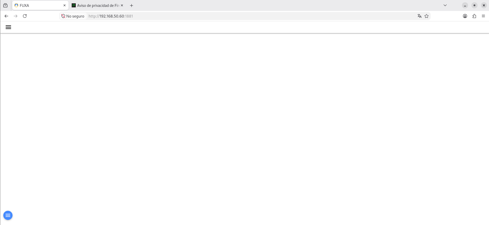
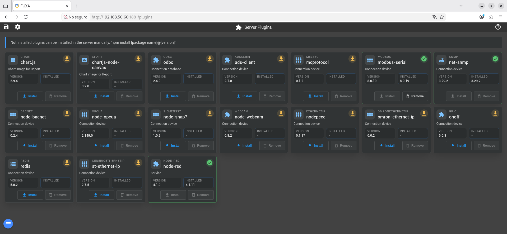
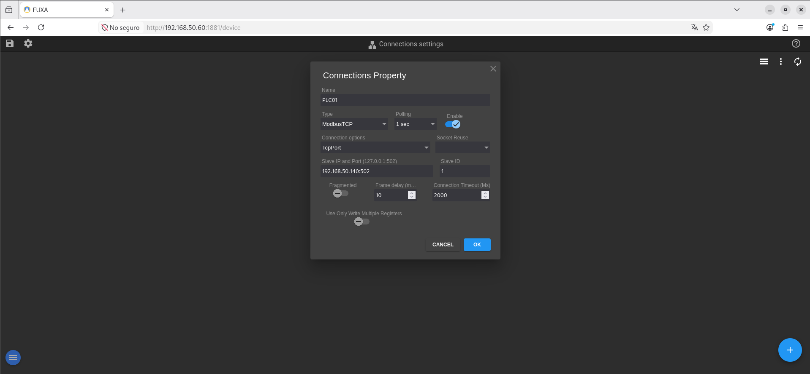
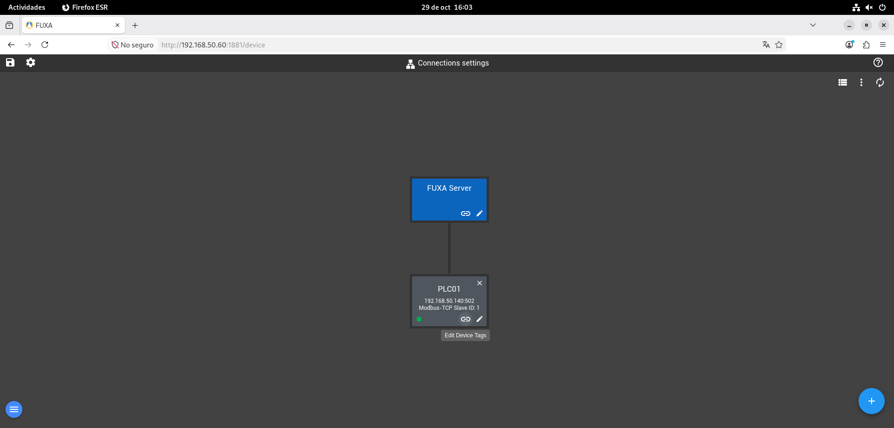
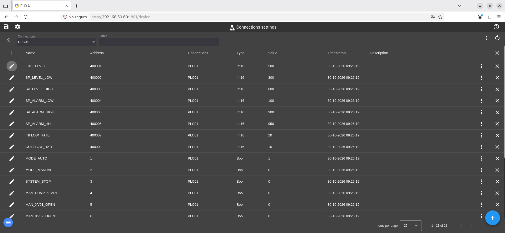
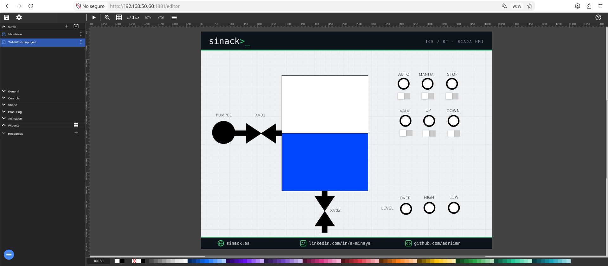

# HMI01 — FUXA HMI

## 1. Overview

**HMI01** is the HMI (Human Machine Interface) workstation responsible for monitoring and controlling the simulated industrial process in **OT-Labs**, using **FUXA** as the visualization platform.

The system runs **Debian 12** as its base operating system and deploys FUXA using Docker. The interface allows operators to monitor the tank level, view device and alarm states, and modify the available control variables through Modbus TCP.

### System Architecture

```text
HMI01
└── Debian 12
    └── Docker Engine
        └── FUXA
```

FUXA communicates with **OpenPLC Runtime (PLC01)** over Modbus TCP to exchange industrial process variables.

## 2. System Specifications

### 2.1. Virtual Machine Resources

| Parameter | Configuration |
|---|---|
| Hostname | `HMI01` |
| Operating System | Debian GNU/Linux 12 (bookworm) |
| CPU | 2 vCPU |
| RAM | 2 GB |
| Storage | 20 GB |

## 3. Network Configuration

### 3.1. IPv4 Addressing

| Parameter | Value |
|---|---|
| IPv4 Address | `192.168.50.60` |
| Subnet Mask | `255.255.255.0` |
| Prefix | `/24` |

### 3.2. Required Communications

| Destination | Port | Protocol | Purpose |
|---|---|---|---|
| HMI01 | 1881 | TCP/HTTP | Access to the FUXA web interface |
| PLC01 | 502 | TCP/Modbus | Reading and writing controller variables |

The IP addresses and network parameters correspond to the environment used during laboratory development and must be adapted when reproducing the infrastructure in another environment.

## 4. Prerequisites

Before starting the deployment, ensure the following requirements are met:

- A virtual machine running Debian 12.
- A user account with `sudo` privileges.
- Network connectivity and Internet access.
- Hardware resources specified in Section 2.
- OpenPLC Runtime deployed on PLC01 and executing the control program.
- Modbus TCP server enabled on PLC01.

## 5. Installation & Configuration

### 5.1. Operating System Preparation

Update the package repositories and upgrade the installed packages:

```bash
sudo apt update
sudo apt full-upgrade -y
```

Install the required tools:

```bash
sudo apt install -y \
  curl \
  ca-certificates
```

### 5.2. Docker Engine Installation

#### 5.2.1. Configure the Official Repository

Create the directory for repository keys:

```bash
sudo install -m 0755 -d /etc/apt/keyrings
```

Import Docker's GPG key:

```bash
curl -fsSL https://download.docker.com/linux/debian/gpg \
  | sudo tee /etc/apt/keyrings/docker.asc > /dev/null

sudo chmod a+r /etc/apt/keyrings/docker.asc
```

Add the Docker repository for Debian 12:

```bash
sudo tee /etc/apt/sources.list.d/docker.sources > /dev/null <<EOF_DOCKER
Types: deb
URIs: https://download.docker.com/linux/debian
Suites: bookworm
Components: stable
Architectures: amd64
Signed-By: /etc/apt/keyrings/docker.asc
EOF_DOCKER
```

Update the package repositories:

```bash
sudo apt update
```

#### 5.2.2. Install Docker and Docker Compose

Install the required packages:

```bash
sudo apt install -y \
  docker-ce \
  docker-ce-cli \
  containerd.io \
  docker-buildx-plugin \
  docker-compose-plugin
```

Enable the Docker service:

```bash
sudo systemctl enable --now docker
```

Add the current user to the `docker` group:

```bash
sudo usermod -aG docker "$USER"
```

Log out and log back in to apply the new group permissions.

Verify access to Docker:

```bash
docker ps
```

### 5.3. FUXA Deployment

#### 5.3.1. Create the Working Directory

```bash
sudo mkdir -p /opt/fuxa
sudo chown "$USER:$USER" /opt/fuxa

cd /opt/fuxa
```

#### 5.3.2. Create the Docker Compose File

Create the configuration file:

```bash
nano compose.yml
```

Add the following content:

```yaml
services:
  fuxa:
    image: frangoteam/fuxa:latest
    container_name: fuxa
    restart: unless-stopped

    ports:
      - "1881:1881"

    volumes:
      - fuxa-data:/usr/src/app/FUXA/server/_appdata
      - fuxa-db:/usr/src/app/FUXA/server/_db
      - fuxa-logs:/usr/src/app/FUXA/server/_logs
      - fuxa-images:/usr/src/app/FUXA/server/_images

volumes:
  fuxa-data:
  fuxa-db:
  fuxa-logs:
  fuxa-images:
```

The volumes preserve application data, the database, logs, and images used by the HMI.

#### 5.3.3. Start FUXA

Validate the configuration file:

```bash
docker compose config
```

Download the image:

```bash
docker compose pull
```

Start the container:

```bash
docker compose up -d
```

#### 5.3.4. Access FUXA

Open a web browser and navigate to:

```text
http://192.168.50.60:1881
```

Verify that the FUXA web interface is displayed.



### 5.4. Modbus TCP Communication Configuration

#### 5.4.1. Install the modbus-serial Plugin

Before establishing a connection with PLC01, install the `modbus-serial` plugin.

```text
http://192.168.50.60:1881/plugins
```



#### 5.4.2. Create the Connection to PLC01

Navigate to:

**Connections**

Click the **+** button to add a new connection.

Select Modbus TCP and configure the connection using the PLC01 parameters:

| Parameter | Value |
|---|---|
| Name | `PLC01` |
| Type | Modbus TCP |
| Polling | 1 sec |
| Connection options | TcpPort |
| Slave IP and Port | 192.168.50.140:502 |
| Slave ID | 1 |



Save the configuration and verify that FUXA establishes communication with the controller.

The connection will display a green indicator when successfully established.

### 5.5. Modbus Variable Mapping

#### 5.5.1. Access the Controller Variables

From **Connections**, click the link button for the `PLC01` device to access its variable configuration.



#### 5.5.2. Configure the Variables

Add the variables used in the control program developed on ENG01.

**Holding Registers**

| Name | Address offset | Type |
|---|---|---|
| LT01_LEVEL | 1 | Int16 |
| SP_LEVEL_LOW | 2 | Int16 |
| SP_LEVEL_HIGH | 3 | Int16 |
| SP_ALARM_LOW | 4 | Int16 |
| SP_ALARM_HIGH | 5 | Int16 |
| SP_ALARM_HH | 6 | Int16 |
| INFLOW_RATE | 7 | Int16 |
| OUTFLOW_RATE | 8 | Int16 |

> **Note:** When configuring the registers, FUXA displays the Modbus address corresponding to the entered *Address offset*. This laboratory uses addresses `400001` through `400008`.

**Coils**

| Name | Address | Type |
|---|---|---|
| MODE_AUTO | 1 | Bool |
| MODE_MANUAL | 2 | Bool |
| SYSTEM_STOP | 3 | Bool |
| MAN_PUMP_START | 4 | Bool |
| MAN_XV01_OPEN | 5 | Bool |
| MAN_XV02_OPEN | 6 | Bool |
| PUMP01_RUN | 9 | Bool |
| LSL01 | 10 | Bool |
| LSH01 | 11 | Bool |
| LSHH01 | 12 | Bool |
| ALM_LOW | 13 | Bool |
| ALM_HIGH | 14 | Bool |
| ALM_HH | 15 | Bool |

These addresses correspond to the memory mapping defined in the OpenPLC Editor project:

- `%QW0`–`%QW7`: eight 16-bit registers.
- `%QX0.0`–`%QX1.6`: Boolean variables exposed as coils.



#### 5.5.3. Import the Modbus Configuration (Alternative)

To simplify laboratory reproduction, a JSON file is provided containing the Modbus TCP connection to PLC01 and all previously configured process variables.

This file allows users to skip the manual connection setup and individual variable mapping described in Sections 5.4.2, 5.5.1, and 5.5.2.

In FUXA, navigate to **Connections** and use the import option to load the file:

**Configuration file:** `PLC01-modbus-config.json`

[Download the PLC01 Modbus TCP configuration](../../../configs/HMI01/PLC01-modbus-config.json)

After importing, verify that the PLC01 IP address matches the one used in your environment and that all variables are correctly configured.

### 5.6. Import the HMI Project

Once Modbus TCP communication has been configured, import the FUXA project containing the industrial tank's graphical interface.

This project allows the process visualization to be reproduced without manually designing every interface element.

From the editing page, open the `Views` tab, select the import icon, and load the file.

**Project file:** `TANK01-hmi-project.json`

[Download the HMI interface configuration](../../../configs/HMI01/TANK01-hmi-project.json)

After importing, verify that the tank's graphical interface displays the level indicators, pump, valves, and alarms.



## 6. Service Management

### Start FUXA

```bash
cd /opt/fuxa
docker compose up -d
```

### Stop FUXA

```bash
cd /opt/fuxa
docker compose down
```

### Restart FUXA

```bash
cd /opt/fuxa
docker compose restart
```

### Check Service Status

```bash
cd /opt/fuxa
docker compose ps
```

### View Logs

```bash
docker logs -f fuxa
```

## 7. Validation

### 7.1. Verify the Container

On HMI01, verify that the FUXA container is running:

```bash
cd /opt/fuxa
docker compose ps
```

The `fuxa` service should have an `Up` status.

### 7.2. Verify Access to the Web Interface

Open a browser and navigate to:

```text
http://<IP_HMI01>:1881
```

Verify that the platform loads correctly.

### 7.3. Verify Communication with PLC01

In FUXA, open **Connections** and check the status of the Modbus TCP connection to PLC01.

Verify that the received values match the variables executed by OpenPLC Runtime.

> **Note:** During laboratory testing, `modbus-serial` was observed to become unavailable after stopping and redeploying FUXA. Whenever the service starts, verify that the plugin is still installed. If it is unavailable, FUXA may display a connection-loss alert for PLC01. It has not yet been confirmed whether this happens only when the container is recreated (`docker compose down` followed by `up -d`) or also when it is restarted (`docker compose restart`).

### 7.4. Verify Process Operation

In the FUXA editor, click **Play** to open the process visualization. The initial tank level should be approximately halfway up. If this is not the case, check the program status on PLC01 and, if necessary, compile and upload it again from ENG01.

#### Test 01 — Manual Filling

Disable `AUTO` mode and enable `MANUAL` mode. Then activate `VALV` and `UP`. The tank level will begin to rise.

#### Test 02 — Manual Draining

Continuing from the previous test, deactivate `VALV` and `UP`. The tank level will begin to fall.

#### Test 03 — Process Stop

Before the tank reaches its minimum level, press `STOP`. According to the behavior observed in the interface, the level will stop decreasing regardless of the selected mode (`MANUAL` or `AUTO`).

#### Test 04 — Automatic Control

When the tank level is below 300, enable `AUTO` mode. The level should increase until it reaches 800.

#### Test 05 — Alarm Activation

In manual mode, lower the tank level until the `LOW` indicator turns red. Then increase the level until the `HIGH` and `OVER` indicators activate, in that order.

## 8. References

- [FUXA — Official GitHub Repository](https://github.com/frangoteam/FUXA)
- [FUXA — Official Documentation](https://frangoteam.github.io/FUXA/)
- [Docker Engine — Debian Installation](https://docs.docker.com/engine/install/debian/)
- [OpenPLC Runtime — GitHub](https://github.com/Autonomy-Logic/openplc-runtime)
