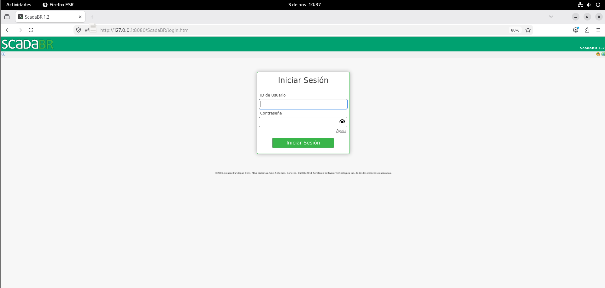
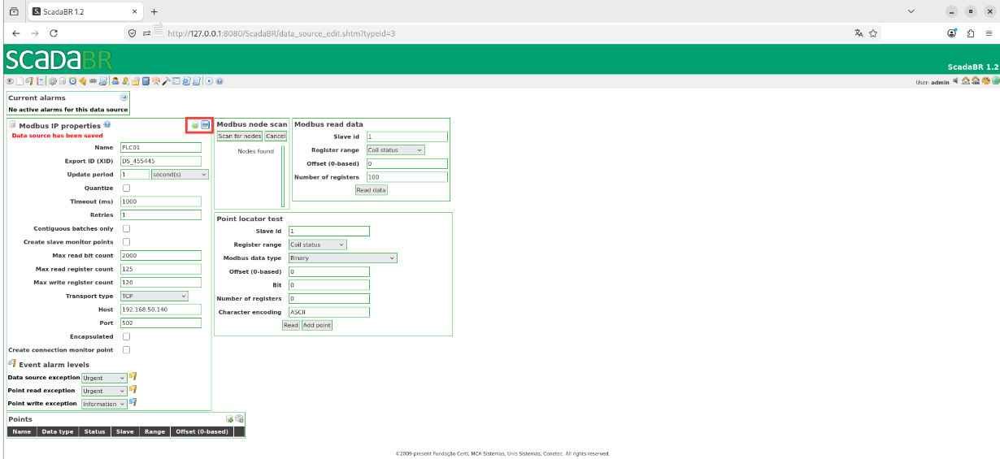
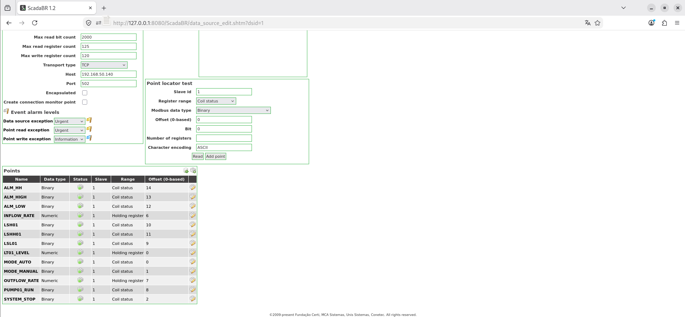
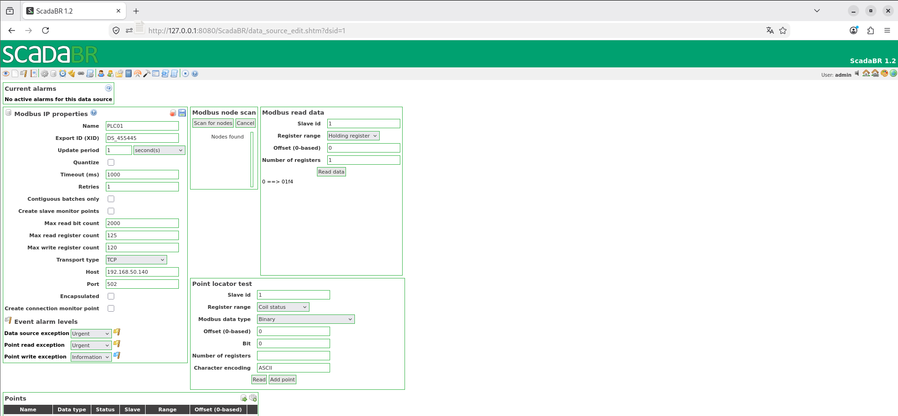
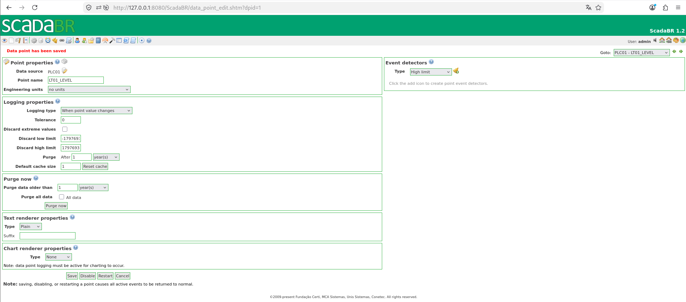
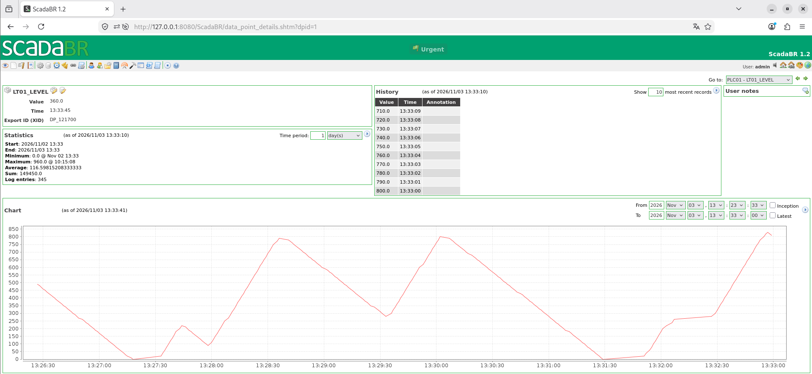
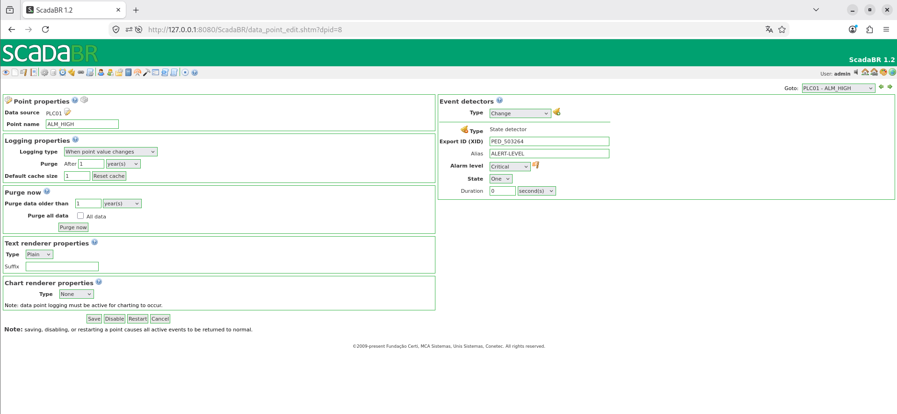

# SCD01 — ScadaBR

## 1. Overview

**SCD01** is the SCADA workstation responsible for supervising the industrial process simulated in **OT-Labs** using **ScadaBR 1.2**. It allows users to monitor PLC01 variables, store historical data, and generate process- and communication-related events and alarms.

Unlike **HMI01 (FUXA)**, which is used to operate the tank, SCD01 is intended for **monitoring and data logging**. Modbus data points will be configured without write permissions in ScadaBR.

### System Architecture

```text
SCD01
└── Debian 12
    └── Docker Engine
        └── Apache Tomcat 9 / Java 8
            └── ScadaBR 1.2
                └── Apache Derby
```

ScadaBR communicates with **OpenPLC Runtime (PLC01)** over **Modbus TCP** on port `502`.

## 2. System Specifications

### 2.1. Virtual Machine Resources

| Parameter | Configuration |
|---|---|
| Hostname | `SCD01` |
| Operating system | Debian GNU/Linux 12 (bookworm) |
| CPU | 2 vCPU |
| RAM | 2 GB (4 GB recommended) |
| Storage | 20 GB |

## 3. Network Configuration

### 3.1. IPv4 Addressing

| Parameter | Value |
|---|---|
| IPv4 address | `192.168.50.80` |
| Subnet mask | `255.255.255.0` |
| Prefix | `/24` |

### 3.2. Required Communications

| Destination | Port | Protocol | Purpose |
|---|---|---|---|
| SCD01 | 8080 | TCP/HTTP | Access to ScadaBR via Tomcat |
| PLC01 | 502 | TCP/Modbus | Reading controller variables |

Network addresses and rules must be adapted to the infrastructure used to reproduce the lab.

## 4. Prerequisites

- A virtual machine with Debian 12 installed.
- A user with `sudo` privileges.
- Internet access to download packages and ScadaBR.
- OpenPLC Runtime deployed on PLC01, with the **TANK01-CONTROL** program running.
- Modbus TCP server enabled on PLC01 and accessible on port `502`.

## 5. Installation & Configuration

### 5.1. Operating System Preparation

Update the system:

```bash
sudo apt update
sudo apt full-upgrade -y
```

Install the required packages:

```bash
sudo apt install -y ca-certificates curl wget unzip
```

### 5.2. Docker Engine Installation

#### 5.2.1. Set Up the Official Repository

Create the keyring directory:

```bash
sudo install -m 0755 -d /etc/apt/keyrings
```

Import the Docker GPG key:

```bash
sudo curl -fsSL https://download.docker.com/linux/debian/gpg \
  -o /etc/apt/keyrings/docker.asc

sudo chmod a+r /etc/apt/keyrings/docker.asc
```

Add the Debian 12 repository:

```bash
sudo tee /etc/apt/sources.list.d/docker.sources > /dev/null <<EOF_DOCKER
Types: deb
URIs: https://download.docker.com/linux/debian
Suites: bookworm
Components: stable
Architectures: $(dpkg --print-architecture)
Signed-By: /etc/apt/keyrings/docker.asc
EOF_DOCKER
```

Update the repositories:

```bash
sudo apt update
```

#### 5.2.2. Install Docker and Docker Compose

```bash
sudo apt install -y \
  docker-ce \
  docker-ce-cli \
  containerd.io \
  docker-buildx-plugin \
  docker-compose-plugin
```

Enable Docker:

```bash
sudo systemctl enable --now docker
```

Verify the installation:

```bash
sudo docker --version
sudo docker compose version
sudo docker ps
```

### 5.3. ScadaBR Deployment

A custom Docker image will be built for ScadaBR using **Apache Tomcat 9 with Java 8** and the application WAR file.

#### 5.3.1. Prepare the Working Directory

```bash
sudo mkdir -p /opt/scadabr
sudo chown "$USER:$USER" /opt/scadabr
cd /opt/scadabr
```

Download ScadaBR 1.2:

```bash
wget https://github.com/ScadaBR/ScadaBR/releases/download/v1.2/ScadaBR.war
```

Extract the WAR contents into the working directory:

```bash
unzip -q ScadaBR.war
```

#### 5.3.2. Configure Apache Derby

ScadaBR will use **Apache Derby** to store configuration and historical process data.

Edit the file:

```bash
nano /opt/scadabr/WEB-INF/classes/env.properties
```

Locate the property:

```properties
db.url=~/db/scadabrDB
```

Replace it with:

```properties
db.url=/var/lib/scadabr/db/scadabrDB
```

This path corresponds to the directory preserved by a Docker volume.

<!-- Optional screenshot: ../../../assets/screenshots/SCD01/01-derby-config.png -->

#### 5.3.3. Create the Dockerfile

```bash
nano /opt/scadabr/Dockerfile
```

```dockerfile
FROM tomcat:9.0.122-jre8-temurin

# Eliminar aplicaciones web predeterminadas
RUN rm -rf /usr/local/tomcat/webapps/*

# Crear directorio para la base de datos Derby
RUN mkdir -p /var/lib/scadabr/db

# Desplegar ScadaBR
COPY . /usr/local/tomcat/webapps/ScadaBR/

# Limitar el consumo de memoria Java
ENV CATALINA_OPTS="-Xms256m -Xmx512m"

# Puerto web de Tomcat
EXPOSE 8080

CMD ["catalina.sh", "run"]
```

#### 5.3.4. Create the .dockerignore File

```bash
nano /opt/scadabr/.dockerignore
```

```text
ScadaBR.war
Dockerfile
compose.yml
.dockerignore
.git
backups/
```

#### 5.3.5. Create the Docker Compose File

```bash
nano /opt/scadabr/compose.yml
```

```yaml
services:
  scadabr:
    build: .
    container_name: scadabr
    restart: unless-stopped

    ports:
      - "8080:8080"

    environment:
      TZ: Europe/Madrid

    volumes:
      - scadabr-data:/var/lib/scadabr

    mem_limit: 1g

volumes:
  scadabr-data:
```

#### 5.3.6. Build and Start ScadaBR

```bash
cd /opt/scadabr
sudo docker compose config
sudo docker pull tomcat:9.0.122-jre8-temurin
sudo docker compose build
sudo docker images
sudo docker compose up -d
```

### 5.4. Access ScadaBR

Open the following address in a web browser:

```text
http://192.168.50.80:8080/ScadaBR/
```
On first access to ScadaBR, sign in using the default installation credentials:

- **Username:** `admin`
- **Password:** `admin`

After signing in, open the user settings and **change the default password** to a secure one before continuing with the system configuration.

> **Note:** these are only the default ScadaBR credentials. They must not be used as the final credentials for the lab.




### 5.5. Modbus TCP Communication Configuration

From the ScadaBR top toolbar, open **Data Sources**.

On the Data Sources screen, select **Modbus IP** and create a new data source.

The **Modbus IP properties** section will open, allowing you to configure communication with PLC01.

Enter the values shown in the following table.

After saving the configuration, verify that the Modbus reading tools and the **Points** section are displayed. The latter is used to manage controller variables.

| Parameter | Configuration |
|---|---|
| Name | `PLC01` |
| Export ID (XID) | Automatically generated |
| Update period | 1 second |
| Quantize | Unchecked |
| Timeout (ms) | 1000 ms |
| Retries | 1 |
| Contiguous batches only | Unchecked |
| Create slave monitor points | Unchecked |
| Max read bit count | 2000 |
| Max read register count | 125 |
| Max write register count | 120 |
| Transport type | TCP |
| Host | `192.168.50.140` |
| Port | `502` |
| Encapsulated | Unchecked |
| Create connection monitor point | Unchecked |

Save and enable the data source.




### 5.6. Modbus Data Point Configuration

ScadaBR uses **zero-based offsets**, unlike the address format displayed in FUXA.

For the memory mapping used in this lab:

```text
Offset ScadaBR para coils = Dirección coil de FUXA - 1
Offset ScadaBR para Holding Registers = Dirección 400001... - 400001
```

All points use **Slave ID `1`** and have **Settable unchecked** to keep SCD01 in monitoring-only mode.

#### 5.6.1. Variable Table

On the `PLC01` data source configuration screen, locate the **Points** section below the Modbus IP properties.

This section allows you to view configured points, check their status, and open their properties using the corresponding edit icon.

To enable a point, click its red indicator in the **Status** column. The indicator will turn green, confirming that the point is enabled.

| Name | Data Type | Slave | Range | Offset | Settable |
|---|---|---:|---|---|---|
| `ALM_HH` | Binary | 1 | Coil status | 14 | Unchecked |
| `ALM_HIGH` | Binary | 1 | Coil status | 13 | Unchecked |
| `ALM_LOW` | Binary | 1 | Coil status | 12 | Unchecked |
| `INFLOW_RATE` | Numeric | 1 | Holding register | 6 | Unchecked |
| `LSH01` | Binary | 1 | Coil status | 10 | Unchecked |
| `LSHH01` | Binary | 1 | Coil status | 11 | Unchecked |
| `LSL01` | Binary | 1 | Coil status | 9 | Unchecked |
| `LT01_LEVEL` | Numeric | 1 | Holding register | 0 | Unchecked |
| `MODE_AUTO` | Binary | 1 | Coil status | 0 | Unchecked |
| `MODE_MANUAL` | Binary | 1 | Coil status | 1 | Unchecked |
| `OUTFLOW_RATE` | Numeric | 1 | Holding register | 7 | Unchecked |
| `PUMP01_RUN` | Binary | 1 | Coil status | 8 | Unchecked |
| `SYSTEM_STOP` | Binary | 1 | Coil status | 2 | Unchecked |

Leaving **Settable** unchecked prevents writes through these ScadaBR points but does not replace network- or PLC-level access controls.



#### 5.6.2. Create and Verify Data Points

Modbus points can be created directly from the **Points** section at the bottom of the `PLC01` Data Source configuration screen by using the add-point button.

Optionally, use **Point locator test** to verify that a Modbus address returns the correct value before adding the point.

To perform read tests using **Modbus read data**, temporarily disable the `PLC01` Data Source by clicking its status indicator until it turns red.

Then enter the parameters for the coil or register test and click **Read data**.

| Parameter | Coil test | Register test |
|---|---|---|
| Slave ID | 1 | 1 |
| Register range | Coil Status | Holding Register |
| Offset (base 0) | 0 | 0 |
| Number of registers | 16 | 1 |

In the second test, ScadaBR displays the `LT01_LEVEL` value in hexadecimal. Convert it to decimal and verify that it matches the value shown in FUXA. For example, `0x01F4` equals `500`.

After completing the tests, re-enable the `PLC01` Data Source to resume periodic variable readings.



### 5.7. Historical Data Logging

#### 5.7.1. Configure LT01_LEVEL History

From **Data Sources**, open the `PLC01` source and locate the `LT01_LEVEL` variable in the **Points** section.

Click the point edit icon to open its configuration.

On the **Point properties** screen, locate **Logging properties**, where historical data storage settings are configured.

Set the parameters listed in the following table and click **Save**.

| Parameter | Configuration |
|---|---|
| Logging type | When point value changes |
| Tolerance | 0 |
| Discard extreme values | Unchecked |
| Purge | After 1 year |
| Default cache size | 1 |

Save the historical logging settings. The level trend can then be viewed in the chart available on the `LT01_LEVEL` point details screen.



Set **When point value changes** as the logging type for any other points whose history you want to retain, to store state changes without continuously recording repeated values.

#### 5.7.2. View Historical Data

From the ScadaBR interface, open the points view and display the details of `LT01_LEVEL`.

The point details screen shows the current value, statistics, historical records, and a time-series chart.

From **HMI01 — FUXA**, change the tank level and verify that the new values are recorded in ScadaBR.




### 5.8. Alarms and Events

ScadaBR can create **Event detectors** associated with Modbus points. TANK01 uses state detectors that activate when the corresponding variable changes to **`1 (TRUE)`**.

#### 5.8.1. Process Event Detectors

From **Data Sources**, open the `PLC01` source and locate the variable to which you want to attach an alarm in the **Points** section.

Click the variable edit icon to open **Point properties**.

In the right-hand panel, find **Event detectors** and follow these steps:

1. In the **Type** dropdown, select `State`.
2. Click the bell icon to create the detector.
3. Enter a descriptive identifier in the **Alias** field.
4. Select the corresponding alarm severity.
5. Set **State** to `One (1)` and **Duration** to `0 seconds`.
6. Click **Save** to save the configuration.

| Variable | Detector type | State | Configured severity |
|---|---|---|---|
| `ALM_LOW` | State | `1 (TRUE)` | Urgent |
| `ALM_HIGH` | State | `1 (TRUE)` | Critical |
| `ALM_HH` | State | `1 (TRUE)` | Live safety |



The `ALM_HIGH` detector screenshot shows the alias **`ALERT-LEVEL`**, **Critical** severity, **One** state, and **0 seconds** duration.

Repeat the procedure for `ALM_LOW`, `ALM_HIGH`, and `ALM_HH`, using the severity levels listed in the table above.

> **Note:** “Live safety” is a severity category available in ScadaBR; in this simulated environment it does not indicate an actual physical risk to people.

## 6. Service Management

### Start ScadaBR

```bash
cd /opt/scadabr
sudo docker compose up -d
```

### Stop ScadaBR

```bash
cd /opt/scadabr
sudo docker compose down
```

### Restart ScadaBR

```bash
cd /opt/scadabr
sudo docker compose restart
```

### Check Status

```bash
cd /opt/scadabr
sudo docker compose ps
```

### View Logs

```bash
sudo docker logs -f scadabr
```

## 7. Validation

### 7.1. Verify the Container and Web Service

```bash
cd /opt/scadabr
sudo docker compose ps
sudo docker logs scadabr
ss -lnt | grep 8080
curl -I http://localhost:8080/ScadaBR/
```

Verify that the container is running and that the web service responds. Depending on the application, `curl -I` may return a redirect or another valid HTTP response; final access must be checked in a browser.

### 7.2. Verify Apache Derby

Check that the database files are stored in the persistent directory:

```bash
sudo docker exec scadabr ls -lah /var/lib/scadabr/db
```

To verify persistence, generate several historical records for `LT01_LEVEL` from the TANK01 process and note one of the recorded values along with its date and time.

On SCD01, recreate the container without deleting the Docker volumes:

```bash
cd /opt/scadabr
sudo docker compose down
sudo docker compose up -d
```

Once ScadaBR has started, open the `LT01_LEVEL` history again and verify that the previous records are still available.

> **Note:** do not use `docker compose down -v`, as this removes the associated volumes and could cause the database to be lost.

### 7.3. Verify Modbus Monitoring

Confirm that the `PLC01` data source is enabled, that all 13 points receive values, and that `LT01_LEVEL` matches the reading displayed in FUXA.

Successful readings, periodic variable updates, and level history recording and visualization have been documented.

### 7.4. Verify Alarms and Events

From the TANK01 process, deliberately trigger low, high, and very-high level conditions in a controlled manner, and verify that ScadaBR generates the corresponding `ALM_LOW`, `ALM_HIGH`, and `ALM_HH` alarms.

### 7.5. Security Considerations

ScadaBR is used for monitoring, with data points configured without write permissions. Access to the web interface must be restricted to the lab environment, and the initial credentials must be changed.

Because ScadaBR 1.2 and its dependencies are outdated, this deployment is intended for an **isolated laboratory environment**, not production.

Process alarms reflect conditions in the monitored variables but do not, by themselves, establish whether the cause is a legitimate action, a failure, or unauthorized activity. Later parts of **OT-Labs** will cover network segmentation and security monitoring.

## 8. References

- [ScadaBR — GitHub Repository](https://github.com/ScadaBR/ScadaBR)
- [ScadaBR — Releases](https://github.com/ScadaBR/ScadaBR/releases)
- [Apache Tomcat](https://tomcat.apache.org/)
- [Docker Engine — Debian Installation](https://docs.docker.com/engine/install/debian/)
- [OpenPLC Runtime — GitHub](https://github.com/Autonomy-Logic/openplc-runtime)

---
