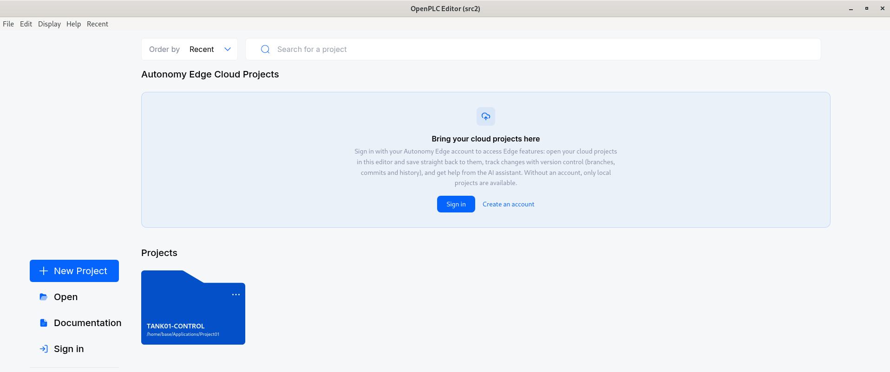
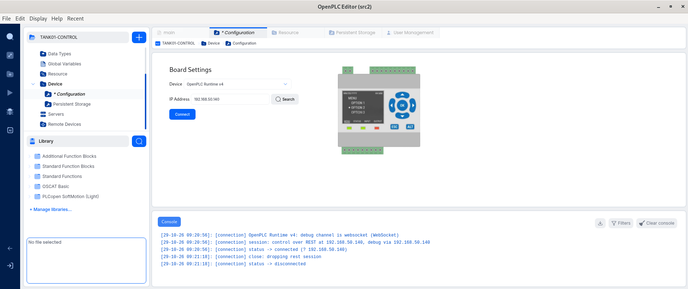
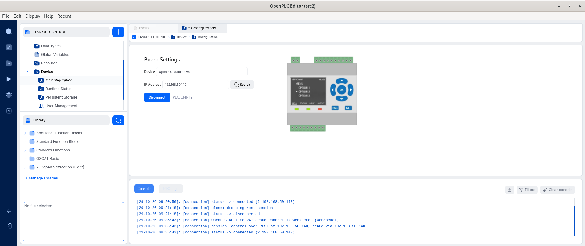
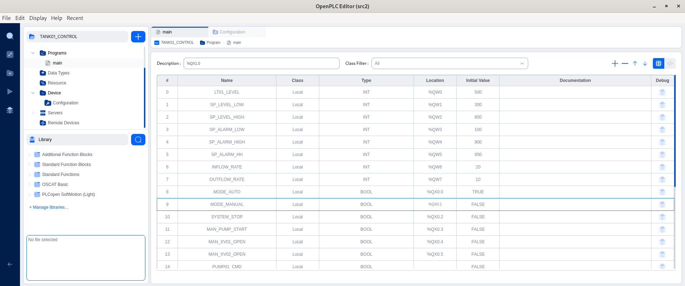
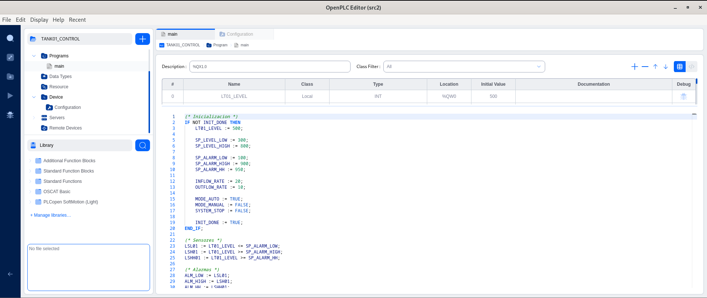
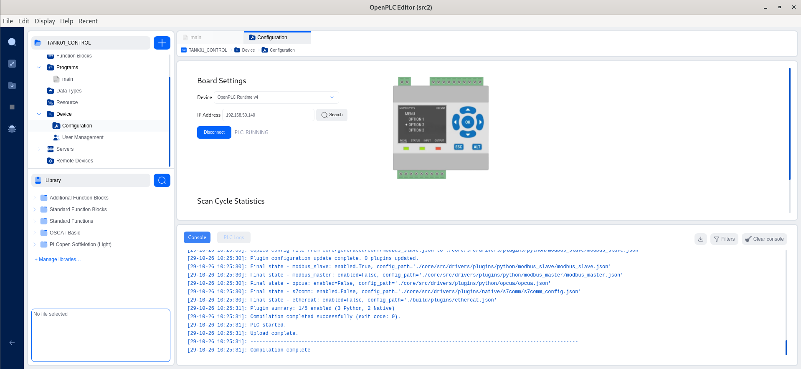
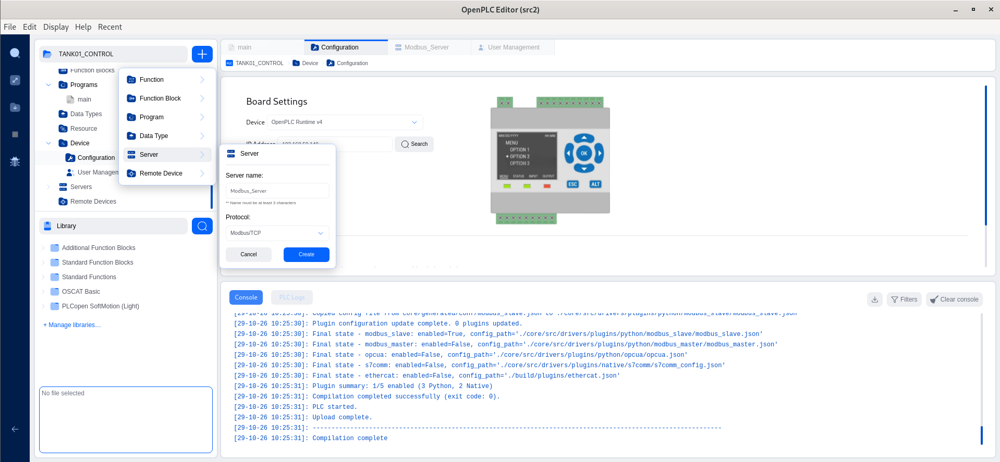
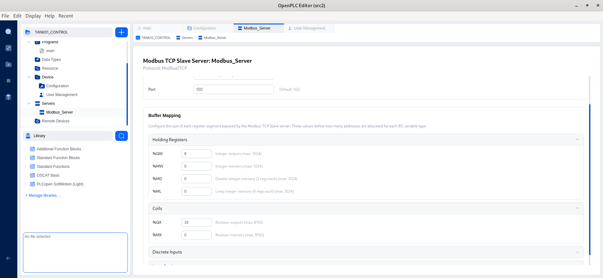
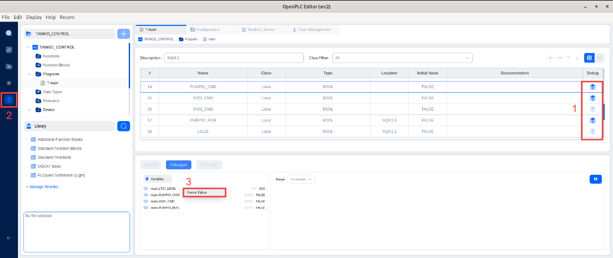
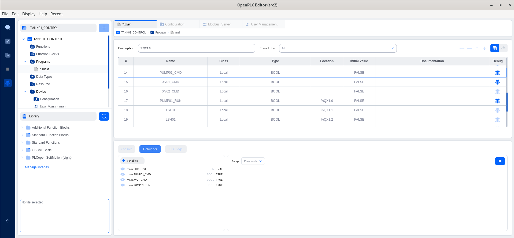

# ENG01 — OpenPLC Editor

## 1. Descripción general

**ENG01** es la estación de ingeniería encargada de desarrollar, compilar, depurar y desplegar la lógica de control del proceso industrial simulado en **OT-Splunk-Lab**, utilizando **OpenPLC Editor** como entorno de programación.

El sistema utiliza **Debian 12** como sistema operativo base y OpenPLC Editor como herramienta de ingeniería para crear y gestionar los programas que posteriormente se ejecutarán en **OpenPLC Runtime (PLC01)**.

### Arquitectura del sistema

```text
ENG01
└── Debian 12
    └── OpenPLC Editor
        └── PLC01 — OpenPLC Runtime
```

OpenPLC Editor permite desarrollar programas de control mediante lenguajes definidos en IEC 61131-3, configurar las comunicaciones industriales y gestionar su despliegue sobre el controlador simulado.

## 2. Características del sistema

### 2.1. Recursos de la máquina virtual

| Parámetro | Configuración |
|---|---|
| Hostname | `ENG01` |
| Sistema operativo | Debian GNU/Linux 12 (bookworm) |
| CPU | 2 vCPU |
| RAM | 2 GB |
| Almacenamiento | 20 GB |

## 3. Configuración de red

### 3.1. Direccionamiento IPv4

| Parámetro | Valor |
|---|---|
| Dirección IPv4 | `192.168.50.40` |
| Máscara | `255.255.255.0` |
| Prefijo | `/24` |

### 3.2. Comunicaciones necesarias

| Destino | Puerto | Protocolo | Función |
|---|---|---|---|
| PLC01 | 8443 | TCP/HTTPS | Conexión con OpenPLC Runtime |
| PLC01 | 502 | TCP/Modbus | Servicio Modbus del controlador |

La dirección IP y los parámetros de red corresponden al entorno utilizado durante el desarrollo del laboratorio y deberán adaptarse cuando se reproduzca en otra infraestructura.

## 4. Requisitos previos

Antes de iniciar el despliegue se requiere:

- Una máquina virtual con Debian 12 instalado.
- Un usuario con permisos `sudo`.
- Conectividad de red y acceso a Internet.
- Recursos de hardware especificados en el apartado 2.
- Acceso a la distribución AppImage de OpenPLC Editor.
- OpenPLC Runtime desplegado en PLC01 para realizar posteriormente la conexión y transferencia del proyecto.

## 5. Instalación y configuración

### 5.1. Preparación del sistema operativo

Actualizar los repositorios y paquetes del sistema:

```bash
sudo apt update
sudo apt full-upgrade -y
```

Instalar las dependencias necesarias:

```bash
sudo apt install -y \
  curl \
  ca-certificates \
  libfuse2
```

### 5.2. Instalación de OpenPLC Editor

#### 5.2.1. Descargar OpenPLC Editor

Descargar la versión **AppImage** de OpenPLC Editor desde la página oficial:

[OpenPLC — Official Website](https://autonomylogic.com/products/openplc)

#### 5.2.2. Preparar el directorio de instalación

Crear el directorio destinado a almacenar la aplicación:

```bash
mkdir -p ~/Applications
```

Mover el archivo AppImage descargado:

```bash
mv ~/Downloads/OpenPLC*.AppImage ~/Applications/
```

Acceder al directorio:

```bash
cd ~/Applications
```

#### 5.2.3. Configurar permisos de ejecución

Conceder permisos de ejecución a la aplicación:

```bash
chmod +x OpenPLC*.AppImage
```

#### 5.2.4. Ejecutar OpenPLC Editor

Iniciar la aplicación:

```bash
./OpenPLC*.AppImage
```

Al ejecutarse correctamente, se mostrará la interfaz principal de OpenPLC Editor.


### 5.3. Creación del proyecto

#### 5.3.1. Crear la carpeta de nuestro proyecto

```bash
mkdir -p ~/Applications/Project01
```

#### 5.3.2. Crear un nuevo proyecto

Desde la interfaz principal de OpenPLC Editor, seleccionar:

**+ New Project → PLC Project**

Configurar el proyecto con los siguientes parámetros:

| Parámetro | Valor |
|---|---|
| Nombre del proyecto | `TANK01-CONTROL` |
| Ruta | `/home/eng01/Applications/Project01` |
| Lenguaje de programación | Structured Text (ST) |




### 5.4. Conexión con OpenPLC Runtime

#### 5.4.1. Comprobar la conectividad

Verificar la comunicación con PLC01:

```bash
ping -c 4 192.168.50.140
```

Comprobar el acceso a la API de OpenPLC Runtime:

```bash
curl -k https://192.168.50.140:8443/api/version
```

**Resultado esperado en la instalación documentada de PLC01:**

```json
{"version":"v4.3.1"}
```

#### 5.4.2. Configurar la conexión

Desde OpenPLC Editor, acceder al menú lateral:

**Device → Configuration**

Configurar los siguientes parámetros:

| Parámetro | Valor |
|---|---|
| Device | OpenPLC Runtime V4 |
| IP Address | `192.168.50.140` |




#### 5.4.3. Creación del primer usuario

Al realizar nuestra primera conexion con el OpenPLC-Runtime de PLC01 nos pide definir las credenciales para crear nuestro primer usuario.

#### 5.4.4. Establecer la conexión

Pulsar **Connect** e introducir las credenciales configuradas para acceder a OpenPLC Runtime.

Comprobar desde la interfaz que el dispositivo aparece conectado y que OpenPLC Editor puede consultar su estado.



### 5.5. Definición de variables

#### 5.5.1. Acceder al programa principal

Desde el menú lateral de OpenPLC Editor, seleccionar:

**Programs → main**

Editar el programa creado por defecto para declarar las variables utilizadas en la simulación del proceso industrial.

#### 5.5.2. Declarar las variables

Las siguientes variables representan el nivel del depósito, los valores de consigna, los modos de funcionamiento, las órdenes de control y las alarmas del sistema.

| # | Name | Class | Type | Location | Initial Value |
|---|---|---|---|---|---|
| 0 | LT01_LEVEL | Local | INT | %QW0 | 500 |
| 1 | SP_LEVEL_LOW | Local | INT | %QW1 | 300 |
| 2 | SP_LEVEL_HIGH | Local | INT | %QW2 | 800 |
| 3 | SP_ALARM_LOW | Local | INT | %QW3 | 100 |
| 4 | SP_ALARM_HIGH | Local | INT | %QW4 | 900 |
| 5 | SP_ALARM_HH | Local | INT | %QW5 | 950 |
| 6 | INFLOW_RATE | Local | INT | %QW6 | 20 |
| 7 | OUTFLOW_RATE | Local | INT | %QW7 | 10 |
| 8 | MODE_AUTO | Local | BOOL | %QX0.0 | TRUE |
| 9 | MODE_MANUAL | Local | BOOL | %QX0.1 | FALSE |
| 10 | SYSTEM_STOP | Local | BOOL | %QX0.2 | FALSE |
| 11 | MAN_PUMP_START | Local | BOOL | %QX0.3 | FALSE |
| 12 | MAN_XV01_OPEN | Local | BOOL | %QX0.4 | FALSE |
| 13 | MAN_XV02_OPEN | Local | BOOL | %QX0.5 | FALSE |
| 14 | PUMP01_CMD | Local | BOOL | — | FALSE |
| 15 | XV01_CMD | Local | BOOL | — | FALSE |
| 16 | XV02_CMD | Local | BOOL | — | FALSE |
| 17 | PUMP01_RUN | Local | BOOL | %QX1.0 | FALSE |
| 18 | LSL01 | Local | BOOL | %QX1.1 | FALSE |
| 19 | LSH01 | Local | BOOL | %QX1.2 | FALSE |
| 20 | LSHH01 | Local | BOOL | %QX1.3 | FALSE |
| 21 | ALM_LOW | Local | BOOL | %QX1.4 | FALSE |
| 22 | ALM_HIGH | Local | BOOL | %QX1.5 | FALSE |
| 23 | ALM_HH | Local | BOOL | %QX1.6 | FALSE |
| 24 | SIM_TIMER | Local | TON | — | — |
| 25 | INIT_DONE | Local | BOOL | — | FALSE |

Las variables con direcciones `%QW` y `%QX` están vinculadas a posiciones de memoria del controlador, mientras que las variables sin dirección asignada se utilizan internamente en la lógica de control.

Este es el bloque para poder copiar y pegar las variables

```text
VAR
    LT01_LEVEL : INT AT %QW0 := 500;
    SP_LEVEL_LOW : INT AT %QW1 := 300;
    SP_LEVEL_HIGH : INT AT %QW2 := 800;
    SP_ALARM_LOW : INT AT %QW3 := 100;
    SP_ALARM_HIGH : INT AT %QW4 := 900;
    SP_ALARM_HH : INT AT %QW5 := 950;
    INFLOW_RATE : INT AT %QW6 := 20;
    OUTFLOW_RATE : INT AT %QW7 := 10;
    MODE_AUTO : BOOL AT %QX0.0 := TRUE;
    MODE_MANUAL : BOOL AT %QX0.1 := FALSE;
    SYSTEM_STOP : BOOL AT %QX0.2 := FALSE;
    MAN_PUMP_START : BOOL AT %QX0.3 := FALSE;
    MAN_XV01_OPEN : BOOL AT %QX0.4 := FALSE;
    MAN_XV02_OPEN : BOOL AT %QX0.5 := FALSE;
    PUMP01_CMD : BOOL := FALSE;
    XV01_CMD : BOOL := FALSE;
    XV02_CMD : BOOL := FALSE;
    PUMP01_RUN : BOOL AT %QX1.0 := FALSE;
    LSL01 : BOOL AT %QX1.1 := FALSE;
    LSH01 : BOOL AT %QX1.2 := FALSE;
    LSHH01 : BOOL AT %QX1.3 := FALSE;
    ALM_LOW : BOOL AT %QX1.4 := FALSE;
    ALM_HIGH : BOOL AT %QX1.5 := FALSE;
    ALM_HH : BOOL AT %QX1.6 := FALSE;
    SIM_TIMER : TON;
    INIT_DONE : BOOL := FALSE;
  END_VAR
```




### 5.6. Programación de la lógica de control

#### 5.6.1. Editar el programa principal

Desde el apartado **Programs**, abrir el programa `main` e implementar la lógica mediante **Structured Text (ST)**.

La lógica reproduce el comportamiento básico de un depósito industrial, incluyendo:

- Control automático del nivel mediante dos valores de consigna.
- Control manual de la bomba y las válvulas.
- Detección de niveles críticos y generación de alarmas.
- Interbloqueos de seguridad.
- Simulación del llenado y vaciado del depósito.
- Limitación del nivel entre 0 y 1000.

#### 5.6.2. Implementar el código Structured Text

Introducir el siguiente código en el programa `main`:

```iecst
(* Initialization *)
IF NOT INIT_DONE THEN
    LT01_LEVEL := 500;

    SP_LEVEL_LOW := 300;
    SP_LEVEL_HIGH := 800;

    SP_ALARM_LOW := 100;
    SP_ALARM_HIGH := 900;
    SP_ALARM_HH := 950;

    INFLOW_RATE := 20;
    OUTFLOW_RATE := 10;

    MODE_AUTO := TRUE;
    MODE_MANUAL := FALSE;
    SYSTEM_STOP := FALSE;

    INIT_DONE := TRUE;
END_IF;

(* Sensors *)
LSL01 := LT01_LEVEL <= SP_ALARM_LOW;
LSH01 := LT01_LEVEL >= SP_ALARM_HIGH;
LSHH01 := LT01_LEVEL >= SP_ALARM_HH;

(* Alarms *)
ALM_LOW := LSL01;
ALM_HIGH := LSH01;
ALM_HH := LSHH01;

(* Automatic Mode *)
IF MODE_AUTO AND NOT SYSTEM_STOP THEN

    IF LT01_LEVEL <= SP_LEVEL_LOW THEN
        PUMP01_CMD := TRUE;
        XV01_CMD := TRUE;
    END_IF;

    IF LT01_LEVEL >= SP_LEVEL_HIGH THEN
        PUMP01_CMD := FALSE;
        XV01_CMD := FALSE;
    END_IF;

END_IF;

(* Manual Mode *)
IF MODE_MANUAL AND NOT SYSTEM_STOP THEN
    PUMP01_CMD := MAN_PUMP_START;
    XV01_CMD := MAN_XV01_OPEN;
    XV02_CMD := MAN_XV02_OPEN;
END_IF;

(* Interlocks *)
IF SYSTEM_STOP THEN
    PUMP01_CMD := FALSE;
    XV01_CMD := FALSE;
    XV02_CMD := FALSE;
END_IF;

IF LSHH01 THEN
    PUMP01_CMD := FALSE;
    XV01_CMD := FALSE;
END_IF;

(* Feedback *)
PUMP01_RUN := PUMP01_CMD;

(* Process Simulation *)
SIM_TIMER(IN := NOT SIM_TIMER.Q, PT := T#1s);

IF SIM_TIMER.Q THEN

    IF PUMP01_RUN AND XV01_CMD THEN
        LT01_LEVEL := LT01_LEVEL + INFLOW_RATE;
    END_IF;

    IF XV02_CMD THEN
        LT01_LEVEL := LT01_LEVEL - OUTFLOW_RATE;
    END_IF;

END_IF;

(* Level Limits *)
IF LT01_LEVEL > 1000 THEN
    LT01_LEVEL := 1000;
END_IF;

IF LT01_LEVEL < 0 THEN
    LT01_LEVEL := 0;
END_IF;
```


#### 5.6.3. Compilar y transferir el programa

Desde OpenPLC Editor, utilizar la opción:

**Build Options → Build and upload**

Comprobar que el proceso de compilación y transferencia finaliza sin errores. 

Revisar que el estado del PLC pasa de `EMPTY` a `RUNNING`.



### 5.7. Configuración del servidor Modbus TCP

#### 5.7.1. Crear el servidor

Desde OpenPLC Editor, acceder a:

**+ → Server**

Crear un nuevo servidor y seleccionar el protocolo **Modbus/TCP**.



#### 5.7.2. Configurar los parámetros de comunicación

Utilizar los siguientes parámetros:

| Parámetro | Configuración |
|---|---|
| Enable Server | Enabled |
| Network Interface | All Interfaces (`0.0.0.0`) |
| Port | `502` |

#### 5.7.3. Configurar el Buffer Mapping

Configurar las áreas de memoria que estarán disponibles mediante Modbus TCP.

**Holding Registers**

```text
%QW = 8
%MW = 0
%MD = 0
%ML = 0
```

**Coils**

```text
%QX = 16
%MX = 0
```



#### 5.7.4. Aplicar la configuración

Guardar la configuración del servidor Modbus TCP mediante `Ctrl+S`, y compilar nuevamente el proyecto para transferirlo a PLC01 mediante Build and upload.

## 6. Gestión de la aplicación

### Iniciar OpenPLC Editor

Acceder al directorio de instalación:

```bash
cd ~/Applications
```

Ejecutar OpenPLC Editor:

```bash
./OpenPLC*.AppImage
```

### Detener OpenPLC Editor

Cerrar la aplicación desde su interfaz gráfica.

Si se ha iniciado desde una terminal en primer plano, también puede finalizarse mediante:

```text
Ctrl + C
```

## 7. Validación

### 7.1. Verificar la conexión con PLC01

Desde **Device Configuration**, comprobar que OpenPLC Editor establece correctamente la conexión con OpenPLC Runtime.

### 7.2. Verificar el despliegue del programa

Tras ejecutar **Build and upload**, comprobar que el programa se ha transferido correctamente y que el controlador se encuentra en ejecución.

Desde PLC01, consultar:

```bash
docker logs openplc-runtime 2>&1 | grep -E 'PLC State|MODBUS_SLAVE'
```

El Runtime debe mostrar el estado:

```text
PLC State: RUNNING
```

Y, tras activar el servidor Modbus TCP, deben observarse mensajes equivalentes a:

```text
 [INFO] [MODBUS_SLAVE] Configuration loaded - Host: 0.0.0.0, Port: 502
 [INFO] [MODBUS_SLAVE] Buffer mapping format: segmented
 [INFO] [MODBUS_SLAVE] Segmented coils: %QX=16 bits, %MX=0 bits, total=16
 [INFO] [MODBUS_SLAVE] Segmented holding registers: %QW=0-7, %MW=8-7, %MD=8-7, %ML=8-7, word_order=high_word_first
 [INFO] [MODBUS_SLAVE] Plugin initialized successfully - Host: 0.0.0.0, Port: 502
 [INFO] [MODBUS_SLAVE] Server listening on 0.0.0.0:502
 [INFO] PLC State: RUNNING

```

### 7.3. Verificar las variables del proceso

Abrir el **Debugger** de OpenPLC Editor y comprobar que las variables del programa pueden visualizarse en tiempo real.



Para validar el control automático, utilizar la opción `Force Value` para establecer temporalmente:

```text
LT01_LEVEL = 250
```

Como el nivel se encuentra por debajo de:

```text
SP_LEVEL_LOW = 300
```

Deben activarse las siguientes variables:

```text
PUMP01_CMD = TRUE
XV01_CMD = TRUE
PUMP01_RUN = TRUE
```


Liberar posteriormente el valor forzado de `LT01_LEVEL` mediante `Release Force`.

Si la simulación se ejecuta correctamente, el nivel debe aumentar progresivamente hasta alcanzar:

```text
SP_LEVEL_HIGH = 800
```

En ese momento, la bomba y la válvula de entrada deben detenerse.

## 8. Referencias

- [OpenPLC — Official Website](https://autonomylogic.com/products/openplc)
- [OpenPLC Runtime — GitHub](https://github.com/Autonomy-Logic/openplc-runtime)
- [IEC 61131-3 — IEC Webstore](https://webstore.iec.ch/)
- [Debian — Official Documentation](https://www.debian.org/doc/)