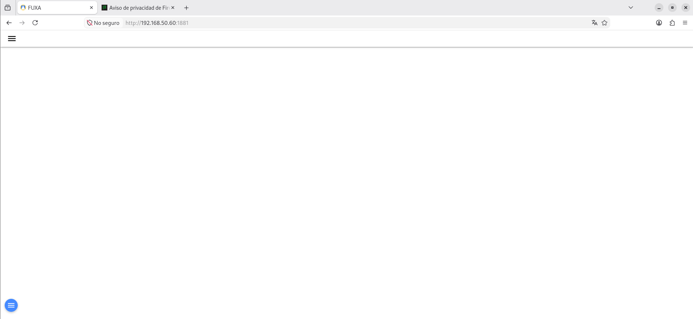
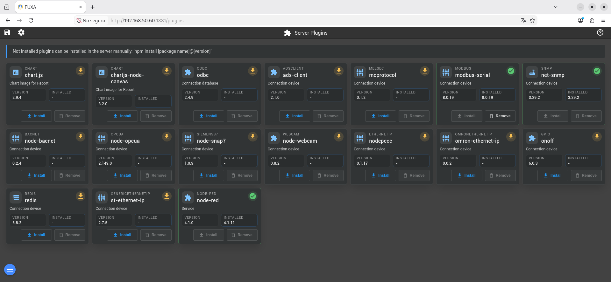
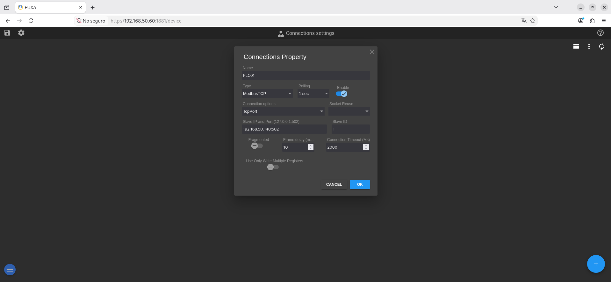
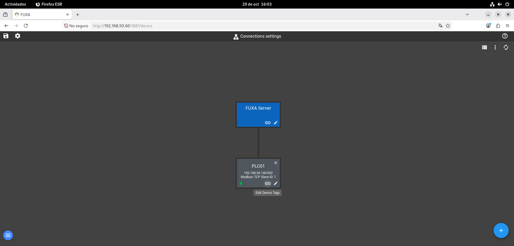
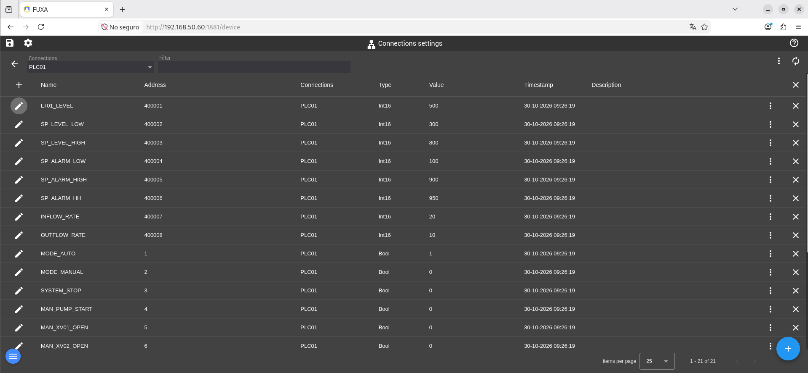
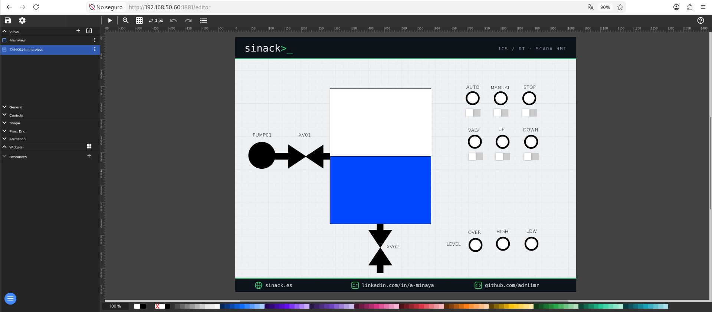

# HMI01 — FUXA HMI

## 1. Descripción general

**HMI01** es la estación HMI (Human Machine Interface) encargada de supervisar y controlar el proceso industrial simulado en **OT-Labs**, utilizando **FUXA** como plataforma de visualización.

El sistema utiliza **Debian 12** como sistema operativo base y ejecuta FUXA mediante Docker. La interfaz permite visualizar el nivel del depósito, consultar el estado de los dispositivos y las alarmas, y modificar las variables de control disponibles mediante Modbus TCP.

### Arquitectura del sistema

```text
HMI01
└── Debian 12
    └── Docker Engine
        └── FUXA
```

FUXA se comunica con **OpenPLC Runtime (PLC01)** mediante Modbus TCP para intercambiar las variables del proceso industrial.

## 2. Características del sistema

### 2.1. Recursos de la máquina virtual

| Parámetro | Configuración |
|---|---|
| Hostname | `HMI01` |
| Sistema operativo | Debian GNU/Linux 12 (bookworm) |
| CPU | 2 vCPU |
| RAM | 2 GB |
| Almacenamiento | 20 GB |

## 3. Configuración de red

### 3.1. Direccionamiento IPv4

| Parámetro | Valor |
|---|---|
| Dirección IPv4 | `192.168.50.60` |
| Máscara | `255.255.255.0` |
| Prefijo | `/24` |

### 3.2. Comunicaciones necesarias

| Destino | Puerto | Protocolo | Función |
|---|---|---|---|
| HMI01 | 1881 | TCP/HTTP | Acceso a la interfaz web de FUXA |
| PLC01 | 502 | TCP/Modbus | Lectura y escritura de variables del controlador |

La dirección IP y los parámetros de red corresponden al entorno utilizado durante el desarrollo del laboratorio y deberán adaptarse cuando se reproduzca en otra infraestructura.

## 4. Requisitos previos

Antes de iniciar el despliegue se requiere:

- Una máquina virtual con Debian 12 instalado.
- Un usuario con permisos `sudo`.
- Conectividad de red y acceso a Internet.
- Recursos de hardware especificados en el apartado 2.
- OpenPLC Runtime desplegado y ejecutando el programa de control en PLC01.
- Servidor Modbus TCP habilitado en PLC01.

## 5. Instalación y configuración

### 5.1. Preparación del sistema operativo

Actualizar los repositorios y paquetes del sistema:

```bash
sudo apt update
sudo apt full-upgrade -y
```

Instalar las herramientas necesarias:

```bash
sudo apt install -y \
  curl \
  ca-certificates
```

### 5.2. Instalación de Docker Engine

#### 5.2.1. Preparar el repositorio oficial

Crear el directorio para las claves de los repositorios:

```bash
sudo install -m 0755 -d /etc/apt/keyrings
```

Importar la clave GPG de Docker:

```bash
curl -fsSL https://download.docker.com/linux/debian/gpg \
  | sudo tee /etc/apt/keyrings/docker.asc > /dev/null

sudo chmod a+r /etc/apt/keyrings/docker.asc
```

Añadir el repositorio de Docker para Debian 12:

```bash
sudo tee /etc/apt/sources.list.d/docker.sources > /dev/null <<EOF
Types: deb
URIs: https://download.docker.com/linux/debian
Suites: bookworm
Components: stable
Architectures: amd64
Signed-By: /etc/apt/keyrings/docker.asc
EOF
```

Actualizar los repositorios:

```bash
sudo apt update
```

#### 5.2.2. Instalar Docker y Docker Compose

Instalar los paquetes necesarios:

```bash
sudo apt install -y \
  docker-ce \
  docker-ce-cli \
  containerd.io \
  docker-buildx-plugin \
  docker-compose-plugin
```

Habilitar el servicio Docker:

```bash
sudo systemctl enable --now docker
```

Añadir el usuario actual al grupo `docker`:

```bash
sudo usermod -aG docker "$USER"
```

Cerrar la sesión y volver a iniciarla para aplicar los permisos.

Verificar el acceso a Docker:

```bash
docker ps
```

### 5.3. Despliegue de FUXA

#### 5.3.1. Crear el directorio de trabajo

```bash
sudo mkdir -p /opt/fuxa
sudo chown "$USER:$USER" /opt/fuxa

cd /opt/fuxa
```

#### 5.3.2. Crear el archivo Docker Compose

Crear el archivo de configuración:

```bash
nano compose.yml
```

Introducir el siguiente contenido:

```yaml
services:
  fuxa:
    image: frangoteam/fuxa:latest
    container_name: fuxa
    restart: unless-stopped

    ports:
      - "1881:1881"

    volumes:
      - fuxa-data:/usr/src/app/FUXA/server/_appdata
      - fuxa-db:/usr/src/app/FUXA/server/_db
      - fuxa-logs:/usr/src/app/FUXA/server/_logs
      - fuxa-images:/usr/src/app/FUXA/server/_images

volumes:
  fuxa-data:
  fuxa-db:
  fuxa-logs:
  fuxa-images:
```

Los volúmenes permiten conservar los datos de la aplicación, la base de datos, los logs y las imágenes utilizadas por el HMI.

#### 5.3.3. Iniciar FUXA

Validar el archivo de configuración:

```bash
docker compose config
```

Descargar la imagen:

```bash
docker compose pull
```

Iniciar el contenedor:

```bash
docker compose up -d
```

#### 5.3.4. Acceder a FUXA

Abrir un navegador web y acceder a:

```text
http://192.168.50.60:1881
```

Comprobar que aparece la interfaz web de FUXA.



### 5.4. Configuración de comunicaciones Modbus TCP

#### 5.4.1. Instalar el plugin modbus-serial

Antes de establecer la conexión con PLC01, es necesario instalar el plugin `modbus-serial`.

```text
http://192.168.50.60:1881/plugins
```




#### 5.4.2. Crear la conexión con PLC01

Acceder al apartado:

**Connections**

Pulsar el botón **+** para añadir una nueva conexión.

Seleccionar Modbus TCP y configurar la conexión utilizando los parámetros de PLC01:

| Parámetro | Valor |
|---|---|
| Name | `PLC01` |
| Type | Modbus TCP |
| Polling| 1 sec |
| Connection options | TcpPort |
| Slave IP and Port | 192.168.50.140:502 |
| Slave ID | 1 |




Guardar la configuración y comprobar que FUXA establece comunicación con el controlador.

La conexión mostrará un indicador verde cuando se establezca correctamente.

### 5.5. Mapeo de variables Modbus

#### 5.5.1. Acceder a las variables del controlador

Desde el apartado **Connections**, seleccionar el botón de enlace del dispositivo `PLC01` para acceder a la configuración de sus variables.



#### 5.5.2. Configurar las variables

Registrar las variables utilizadas en el programa de control desarrollado desde ENG01.

**Holding Registers**

| Name | Address offset | Type |
|---|---|---|
| LT01_LEVEL | 1 | Int16 |
| SP_LEVEL_LOW | 2 | Int16 |
| SP_LEVEL_HIGH | 3 | Int16 |
| SP_ALARM_LOW | 4 | Int16 |
| SP_ALARM_HIGH | 5 | Int16 |
| SP_ALARM_HH | 6 | Int16 |
| INFLOW_RATE | 7 | Int16 |
| OUTFLOW_RATE | 8 | Int16 |

> **Nota:** Al configurar los registros, FUXA muestra la dirección Modbus correspondiente al desplazamiento (*Address offset*) introducido. En este laboratorio se utilizan las direcciones `400001` a `400008`.

**Coils**

| Name | Address | Type |
|---|---|---|
| MODE_AUTO | 1 | Bool |
| MODE_MANUAL | 2 | Bool |
| SYSTEM_STOP | 3 | Bool |
| MAN_PUMP_START | 4 | Bool |
| MAN_XV01_OPEN | 5 | Bool |
| MAN_XV02_OPEN | 6 | Bool |
| PUMP01_RUN | 9 | Bool |
| LSL01 | 10 | Bool |
| LSH01 | 11 | Bool |
| LSHH01 | 12 | Bool |
| ALM_LOW | 13 | Bool |
| ALM_HIGH | 14 | Bool |
| ALM_HH | 15 | Bool |

Las direcciones corresponden al mapeo de memoria definido en el proyecto de OpenPLC Editor:

- `%QW0`–`%QW7`: ocho registros de 16 bits.
- `%QX0.0`–`%QX1.6`: variables booleanas expuestas mediante coils.



#### 5.5.3. Importación de la configuración Modbus (alternativa)

Para facilitar la reproducción del laboratorio, se proporciona un archivo JSON que contiene la conexión Modbus TCP con PLC01 y todas las variables del proceso previamente configuradas.

Este archivo permite omitir la configuración manual de la conexión y el mapeo individual de las variables descritos en los apartados 5.4.2, 5.5.1 y 5.5.2.

Desde FUXA, acceder al apartado **Connections** y utilizar la opción de importación para cargar el archivo:

**Archivo de configuración:** `PLC01-modbus-config.json`

[Descargar configuración Modbus TCP de PLC01](../../../configs/HMI01/PLC01-modbus-config.json)

Una vez importado, comprobar que la dirección IP de PLC01 corresponde a la utilizada en el entorno y verificar que todas las variables aparecen correctamente configuradas.

### 5.6. Importación del proyecto HMI

Una vez configurada la comunicación Modbus TCP, importar el proyecto de FUXA que contiene la interfaz gráfica del depósito industrial.

Este proyecto permite reproducir la visualización del proceso sin necesidad de diseñar manualmente todos los elementos de la interfaz.

Desde la página de edición, abrir la pestaña `Views`, seleccionar el icono de importación y cargar el archivo.

**Archivo del proyecto:** `TANK01-hmi-project.json`

[Descargar configuración de la interfaz del HMI](../../../configs/HMI01/TANK01-hmi-project.json)

Tras finalizar la importación, comprobar que se muestra la interfaz gráfica del depósito con los indicadores de nivel, bomba, válvulas y alarmas.




## 6. Gestión del servicio

### Iniciar FUXA

```bash
cd /opt/fuxa
docker compose up -d
```

### Detener FUXA

```bash
cd /opt/fuxa
docker compose down
```

### Reiniciar FUXA

```bash
cd /opt/fuxa
docker compose restart
```

### Consultar el estado

```bash
cd /opt/fuxa
docker compose ps
```

### Consultar los logs

```bash
docker logs -f fuxa
```

## 7. Validación

### 7.1. Verificar el contenedor

Desde HMI01, comprobar que el contenedor de FUXA se encuentra en ejecución:

```bash
cd /opt/fuxa
docker compose ps
```

El servicio `fuxa` debe aparecer en estado `Up`.

### 7.2. Verificar el acceso a la interfaz web

Acceder desde un navegador a:

```text
http://<IP_HMI01>:1881
```

Comprobar que la plataforma carga correctamente.

### 7.3. Verificar la comunicación con PLC01

Desde FUXA, abrir el apartado **Connections** y comprobar el estado de la conexión Modbus TCP con PLC01.

Verificar que los valores recibidos corresponden a las variables ejecutadas por OpenPLC Runtime.

> **Nota:** En las pruebas del laboratorio se ha observado que `modbus-serial` puede dejar de estar disponible tras detener y volver a desplegar FUXA. Al iniciar el servicio, comprobar que el plugin sigue instalado. Si no está disponible, FUXA puede mostrar una alerta de pérdida de conexión con PLC01.


### 7.4. Verificar el funcionamiento del proceso

Desde el editor de FUXA, pulsar el botón **Play** para abrir el proceso. El nivel inicial del tanque debería situarse aproximadamente a la mitad. Si no es así, comprobar el estado del programa en PLC01 y, si es necesario, volver a compilarlo y transferirlo desde ENG01.

#### Prueba 01 — Llenado manual

Desactivar el modo `AUTO` y activar el modo `MANUAL`. A continuación, activar `VALV` y `UP`. El nivel del tanque comenzará a subir.

#### Prueba 02 — Vaciado manual

Continuando con la prueba anterior, desactivar `VALV` y `UP`. El nivel del tanque comenzará a bajar.

#### Prueba 03 — Parada del proceso

Antes de que el nivel llegue al mínimo, pulsar `STOP`. Según el comportamiento observado en la interfaz, la bajada del nivel se detendrá independientemente del modo seleccionado (`MANUAL` o `AUTO`).

#### Prueba 04 — Control automático

Cuando el nivel del tanque se encuentre por debajo de 300, activar el modo `AUTO`. El nivel debería aumentar hasta alcanzar 800.

#### Prueba 05 — Activación de alarmas

En modo manual, bajar el nivel del tanque hasta que se encienda en rojo el indicador `LOW`. Después, aumentar el nivel hasta que se activen, en ese orden, los indicadores `HIGH` y `OVER`.

## 8. Referencias

- [FUXA — Official GitHub Repository](https://github.com/frangoteam/FUXA)
- [FUXA — Official Documentation](https://frangoteam.github.io/FUXA/)
- [Docker Engine — Debian Installation](https://docs.docker.com/engine/install/debian/)
- [OpenPLC Runtime — GitHub](https://github.com/Autonomy-Logic/openplc-runtime)