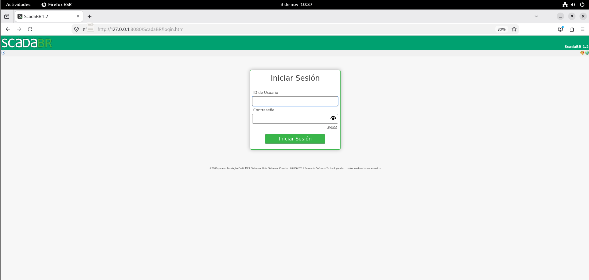
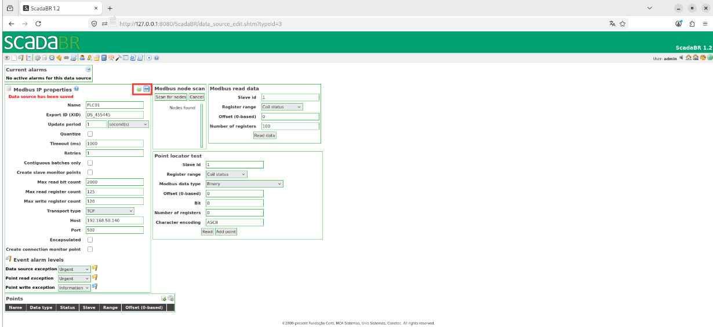
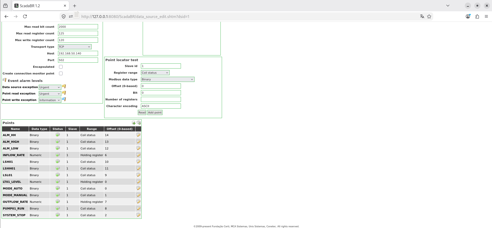
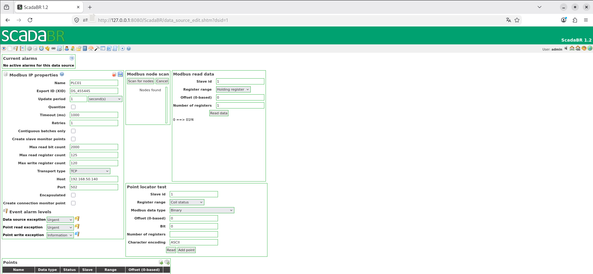
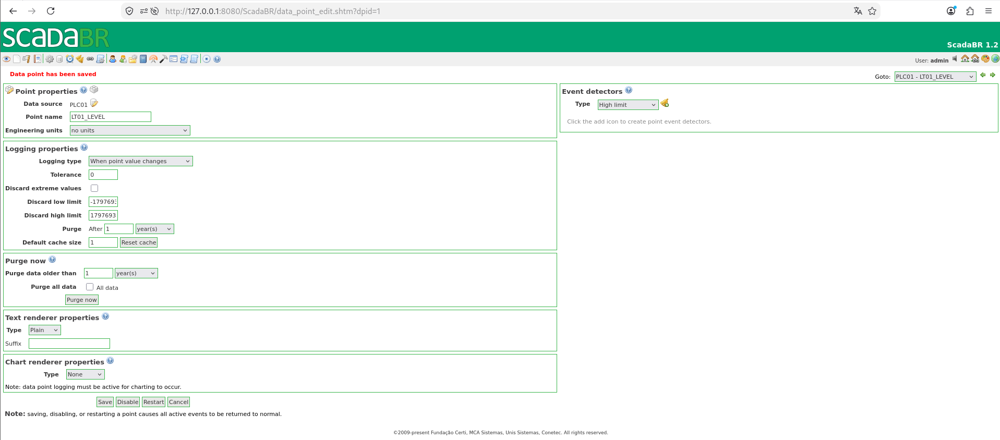
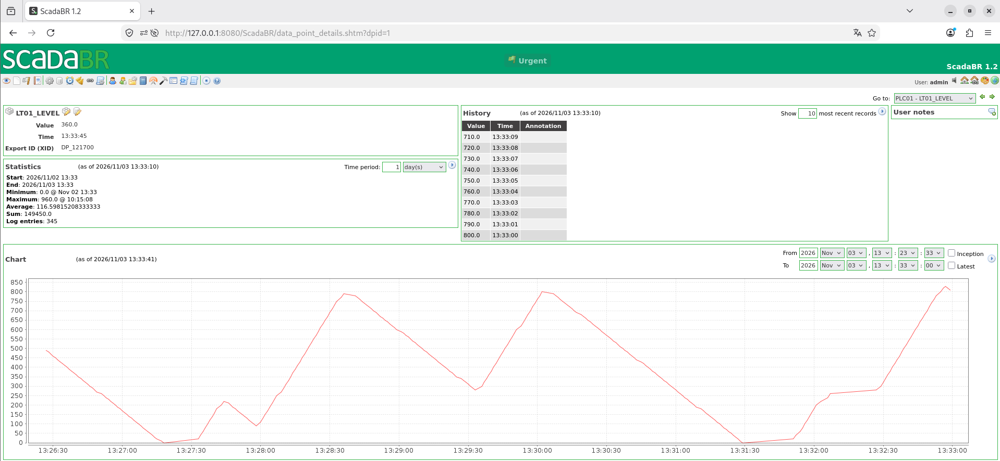
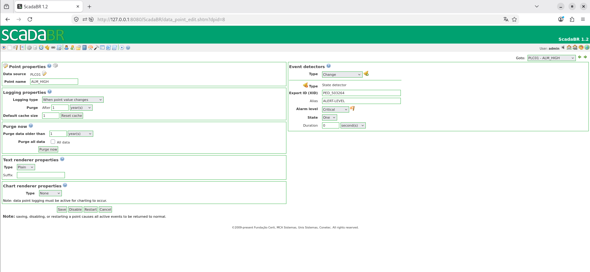

# SCD01 — ScadaBR

## 1. Descripción general

**SCD01** es la estación SCADA encargada de supervisar el proceso industrial simulado en **OT-Labs** mediante **ScadaBR 1.2**. Permite consultar variables de PLC01, almacenar su evolución histórica y generar eventos y alarmas asociados al proceso y a las comunicaciones.

A diferencia de **HMI01 (FUXA)**, que permite operar el depósito, SCD01 se utilizará para **supervisión y registro**. Los puntos Modbus se configurarán sin permisos de modificación desde ScadaBR.

### Arquitectura del sistema

```text
SCD01
└── Debian 12
    └── Docker Engine
        └── Apache Tomcat 9 / Java 8
            └── ScadaBR 1.2
                └── Apache Derby
```

ScadaBR se comunica con **OpenPLC Runtime (PLC01)** mediante **Modbus TCP** por el puerto `502`.

## 2. Características del sistema

### 2.1. Recursos de la máquina virtual

| Parámetro | Configuración |
|---|---|
| Hostname | `SCD01` |
| Sistema operativo | Debian GNU/Linux 12 (bookworm) |
| CPU | 2 vCPU |
| RAM | 2 GB (4 GB recomendados) |
| Almacenamiento | 20 GB |

## 3. Configuración de red

### 3.1. Direccionamiento IPv4

| Parámetro | Valor |
|---|---|
| Dirección IPv4 | `192.168.50.80` |
| Máscara | `255.255.255.0` |
| Prefijo | `/24` |

### 3.2. Comunicaciones necesarias

| Destino | Puerto | Protocolo | Función |
|---|---|---|---|
| SCD01 | 8080 | TCP/HTTP | Acceso a ScadaBR mediante Tomcat |
| PLC01 | 502 | TCP/Modbus | Lectura de variables del controlador |

Las direcciones y reglas de red deben adaptarse a la infraestructura donde se reproduzca el laboratorio.

## 4. Requisitos previos

- Una máquina virtual con Debian 12 instalado.
- Un usuario con permisos `sudo`.
- Acceso a Internet para descargar los paquetes y ScadaBR.
- OpenPLC Runtime desplegado en PLC01, con el programa **TANK01-CONTROL** en ejecución.
- Servidor Modbus TCP habilitado en PLC01 y accesible por el puerto `502`.

## 5. Instalación y configuración

### 5.1. Preparación del sistema operativo

Actualizar el sistema:

```bash
sudo apt update
sudo apt full-upgrade -y
```

Instalar los paquetes necesarios:

```bash
sudo apt install -y ca-certificates curl wget unzip
```

### 5.2. Instalación de Docker Engine

#### 5.2.1. Preparar el repositorio oficial

Crear el directorio de claves:

```bash
sudo install -m 0755 -d /etc/apt/keyrings
```

Importar la clave GPG de Docker:

```bash
sudo curl -fsSL https://download.docker.com/linux/debian/gpg \
  -o /etc/apt/keyrings/docker.asc

sudo chmod a+r /etc/apt/keyrings/docker.asc
```

Añadir el repositorio para Debian 12:

```bash
sudo tee /etc/apt/sources.list.d/docker.sources > /dev/null <<EOF_DOCKER
Types: deb
URIs: https://download.docker.com/linux/debian
Suites: bookworm
Components: stable
Architectures: $(dpkg --print-architecture)
Signed-By: /etc/apt/keyrings/docker.asc
EOF_DOCKER
```

Actualizar los repositorios:

```bash
sudo apt update
```

#### 5.2.2. Instalar Docker y Docker Compose

```bash
sudo apt install -y \
  docker-ce \
  docker-ce-cli \
  containerd.io \
  docker-buildx-plugin \
  docker-compose-plugin
```

Habilitar Docker:

```bash
sudo systemctl enable --now docker
```

Verificar la instalación:

```bash
sudo docker --version
sudo docker compose version
sudo docker ps
```

### 5.3. Despliegue de ScadaBR

Para ScadaBR se construirá una imagen Docker propia a partir de **Apache Tomcat 9 con Java 8** y el archivo WAR de la aplicación.

#### 5.3.1. Preparar el directorio de trabajo

```bash
sudo mkdir -p /opt/scadabr
sudo chown "$USER:$USER" /opt/scadabr
cd /opt/scadabr
```

Descargar ScadaBR 1.2:

```bash
wget https://github.com/ScadaBR/ScadaBR/releases/download/v1.2/ScadaBR.war
```

Extraer el contenido del WAR en el directorio de trabajo:

```bash
unzip -q ScadaBR.war
```

#### 5.3.2. Configurar Apache Derby

ScadaBR utilizará **Apache Derby** para almacenar la configuración y los datos históricos del proceso.

Editar el archivo:

```bash
nano /opt/scadabr/WEB-INF/classes/env.properties
```

Localizar la propiedad:

```properties
db.url=~/db/scadabrDB
```

Sustituirla por:

```properties
db.url=/var/lib/scadabr/db/scadabrDB
```

Esta ruta corresponde al directorio que se conservará mediante un volumen Docker.

<!-- Captura opcional: ../../../assets/screenshots/SCD01/01-derby-config.png -->

#### 5.3.3. Crear el Dockerfile

```bash
nano /opt/scadabr/Dockerfile
```

```dockerfile
FROM tomcat:9.0.122-jre8-temurin

# Eliminar aplicaciones web predeterminadas
RUN rm -rf /usr/local/tomcat/webapps/*

# Crear directorio para la base de datos Derby
RUN mkdir -p /var/lib/scadabr/db

# Desplegar ScadaBR
COPY . /usr/local/tomcat/webapps/ScadaBR/

# Limitar el consumo de memoria Java
ENV CATALINA_OPTS="-Xms256m -Xmx512m"

# Puerto web de Tomcat
EXPOSE 8080

CMD ["catalina.sh", "run"]
```

#### 5.3.4. Crear el archivo .dockerignore

```bash
nano /opt/scadabr/.dockerignore
```

```text
ScadaBR.war
Dockerfile
compose.yml
.dockerignore
.git
backups/
```

#### 5.3.5. Crear Docker Compose

```bash
nano /opt/scadabr/compose.yml
```

```yaml
services:
  scadabr:
    build: .
    container_name: scadabr
    restart: unless-stopped

    ports:
      - "8080:8080"

    environment:
      TZ: Europe/Madrid

    volumes:
      - scadabr-data:/var/lib/scadabr

    mem_limit: 1g

volumes:
  scadabr-data:
```

#### 5.3.6. Construir e iniciar ScadaBR

```bash
cd /opt/scadabr
sudo docker compose config
sudo docker pull tomcat:9.0.122-jre8-temurin
sudo docker compose build
sudo docker images
sudo docker compose up -d
```

### 5.4. Acceso a ScadaBR

Abrir desde un navegador:

```text
http://192.168.50.80:8080/ScadaBR/
```
En el primer acceso a ScadaBR, iniciar sesión utilizando las credenciales predeterminadas de la instalación:

- **Usuario:** `admin`
- **Contraseña:** `admin`

Una vez iniciada la sesión, acceder a la configuración del usuario y **cambiar la contraseña predeterminada** por una contraseña segura antes de continuar con la configuración del sistema.

> **Nota:** estas credenciales corresponden únicamente a los valores predeterminados de ScadaBR. No deben utilizarse en la configuración definitiva del laboratorio.




### 5.5. Configuración de la comunicación Modbus TCP

Desde la barra de herramientas superior de ScadaBR, acceder al apartado **Data Sources** (Fuentes de datos).

En la pantalla de fuentes de datos, seleccionar el tipo **Modbus IP** y crear una nueva fuente de datos.

Se abrirá el apartado **Modbus IP properties**, donde se configurarán los parámetros de comunicación con PLC01.

Introducir los valores indicados en la siguiente tabla.

Tras guardar la configuración, comprobar que aparecen las herramientas de lectura Modbus y el apartado **Points**, desde el que se gestionarán las variables del controlador.

| Parámetro | Configuración |
|---|---|
| Name | `PLC01` |
| Export ID (XID) | Generado automáticamente |
| Update period | 1 segundo |
| Quantize | Desmarcado |
| Timeout (ms) | 1000 ms |
| Retries | 1 |
| Contiguous batches only | Desmarcado |
| Create slave monitor points | Desmarcado |
| Max read bit count | 2000 |
| Max read register count | 125 |
| Max write register count | 120 |
| Transport type | TCP |
| Host | `192.168.50.140` |
| Port | `502` |
| Encapsulated | Desmarcado |
| Create connection monitor point | Desmarcado |

Guardar y habilitar la fuente de datos.




### 5.6. Configuración de puntos Modbus

ScadaBR utiliza **offsets basados en cero**, a diferencia de la presentación de direcciones utilizada en FUXA.

Para el mapeo de este laboratorio:

```text
Offset ScadaBR para coils = Dirección coil de FUXA - 1
Offset ScadaBR para Holding Registers = Dirección 400001... - 400001
```

Todos los puntos utilizan **Slave ID `1`** y se configuran con **Settable desmarcado** para mantener SCD01 en modo de supervisión.

#### 5.6.1. Tabla de variables

En la pantalla de configuración de la fuente de datos `PLC01`, localizar el apartado **Points**, situado debajo de las propiedades Modbus IP.

Desde este apartado se pueden consultar los puntos configurados, comprobar su estado y acceder a sus propiedades mediante el icono de edición correspondiente.

Para habilitar un punto, pulsar sobre su indicador rojo en la columna **Status**. Cuando cambie a verde, el punto quedará habilitado.

| Name | Data Type | Slave | Range | Offset | Settable |
|---|---|---:|---|---|---|
| `ALM_HH` | Binary | 1 | Coil status | 14 | Desmarcado |
| `ALM_HIGH` | Binary | 1 | Coil status | 13 | Desmarcado |
| `ALM_LOW` | Binary | 1 | Coil status | 12 | Desmarcado |
| `INFLOW_RATE` | Numeric | 1 | Holding register | 6 | Desmarcado |
| `LSH01` | Binary | 1 | Coil status | 10 | Desmarcado |
| `LSHH01` | Binary | 1 | Coil status | 11 | Desmarcado |
| `LSL01` | Binary | 1 | Coil status | 9 | Desmarcado |
| `LT01_LEVEL` | Numeric | 1 | Holding register | 0 | Desmarcado |
| `MODE_AUTO` | Binary | 1 | Coil status | 0 | Desmarcado |
| `MODE_MANUAL` | Binary | 1 | Coil status | 1 | Desmarcado |
| `OUTFLOW_RATE` | Numeric | 1 | Holding register | 7 | Desmarcado |
| `PUMP01_RUN` | Binary | 1 | Coil status | 8 | Desmarcado |
| `SYSTEM_STOP` | Binary | 1 | Coil status | 2 | Desmarcado |

La casilla **Settable** desmarcada deshabilita la escritura desde estos puntos de ScadaBR, pero no sustituye los controles de acceso de red o del PLC.



#### 5.6.2. Crear y verificar puntos

Los puntos Modbus se pueden crear directamente desde el apartado **Points**, situado en la parte inferior de la configuración del Data Source `PLC01`, utilizando el botón de añadir puntos.

Opcionalmente, se puede utilizar la herramienta **Point locator test** para comprobar que una dirección Modbus devuelve correctamente su valor antes de añadir el punto.

Para realizar pruebas de lectura mediante **Modbus read data**, es necesario deshabilitar temporalmente el Data Source `PLC01`, pulsando sobre su indicador de estado hasta que aparezca en rojo.

A continuación, introducir los parámetros correspondientes a la prueba de coils o registros y pulsar **Read data**.

| Parámetro | Prueba de coils | Prueba de registro |
|---|---|---|
| Slave ID | 1 | 1 |
| Register range | Coil Status | Holding Register |
| Offset (base 0) | 0 | 0 |
| Number of registers | 16 | 1 |

En la segunda prueba, ScadaBR mostrará el valor de `LT01_LEVEL` en hexadecimal. Convertirlo a decimal y comprobar que coincide con el valor mostrado en FUXA. Por ejemplo, `0x01F4` equivale a `500`.

Una vez finalizadas las pruebas, volver a habilitar el Data Source `PLC01` para restablecer la lectura periódica de las variables.



### 5.7. Registro histórico

#### 5.7.1. Configurar el histórico de LT01_LEVEL

Desde **Data Sources**, abrir la fuente `PLC01` y localizar la variable `LT01_LEVEL` en el apartado **Points**.

Pulsar sobre el icono de edición del punto para acceder a su configuración.

En la pantalla **Point properties**, localizar el apartado **Logging properties**, donde se establecen las opciones de almacenamiento histórico.

Configurar los parámetros indicados en la siguiente tabla y pulsar **Save** para guardar los cambios.

| Parámetro | Configuración |
|---|---|
| Logging type | When point value changes |
| Tolerance | 0 |
| Discard extreme values | Desmarcado |
| Purge | Posterior a 1 año |
| Default cache size | 1 |

Guardar la configuración del registro histórico. Posteriormente, desde la pantalla de detalles de `LT01_LEVEL`, se podrá consultar la evolución temporal del nivel del depósito mediante su gráfico.



Configurar el registro **When point value changes** en el resto de puntos que se desee historizar, para almacenar cambios de estado sin registrar continuamente valores repetidos.

#### 5.7.2. Consultar el histórico

Desde la interfaz de ScadaBR, acceder a la visualización de los puntos y abrir los detalles de `LT01_LEVEL`.

En la pantalla de detalles del punto se muestran el valor actual, las estadísticas, el histórico de registros y el gráfico de evolución temporal.

Desde **HMI01 — FUXA**, modificar el nivel del depósito y comprobar que los nuevos valores aparecen registrados en ScadaBR.




### 5.8. Alarmas y eventos

ScadaBR permite crear **Event detectors** asociados a los puntos Modbus. En TANK01 se utilizan detectores de estado que se activan cuando el valor de la variable pasa a **`1 (TRUE)`**.

#### 5.8.1. Detectores del proceso

Desde **Data Sources**, acceder a la fuente `PLC01` y localizar en el apartado **Points** la variable a la que se desea asociar una alarma.

Pulsar sobre el icono de edición de la variable para abrir la pantalla **Point properties**.

En el panel derecho, localizar el apartado **Event detectors** y seguir estos pasos:

1. En el desplegable **Type**, seleccionar `State`.
2. Pulsar el icono de la campana para crear el detector.
3. Introducir un identificador descriptivo en el campo **Alias**.
4. Seleccionar el nivel de alarma correspondiente.
5. Establecer **State** en `One (1)` y **Duration** en `0 seconds`.
6. Pulsar **Save** para guardar la configuración.

| Variable | Tipo de detector | Estado | Severidad configurada |
|---|---|---|---|
| `ALM_LOW` | Estado | `1 (TRUE)` | Urgent |
| `ALM_HIGH` | Estado | `1 (TRUE)` | Critical |
| `ALM_HH` | Estado | `1 (TRUE)` | Live safety |



La captura aportada del detector `ALM_HIGH` muestra el alias **`ALERT-LEVEL`**, severidad **Critical**, estado **One** y duración **0 seconds**.

Repetir el procedimiento para `ALM_LOW`, `ALM_HIGH` y `ALM_HH`, utilizando las severidades definidas en la tabla anterior.

> **Nota:** «Live safety» es una categoría de severidad disponible en ScadaBR; en este entorno simulado no representa un riesgo físico real para personas.

## 6. Gestión del servicio

### Iniciar ScadaBR

```bash
cd /opt/scadabr
sudo docker compose up -d
```

### Detener ScadaBR

```bash
cd /opt/scadabr
sudo docker compose down
```

### Reiniciar ScadaBR

```bash
cd /opt/scadabr
sudo docker compose restart
```

### Consultar el estado

```bash
cd /opt/scadabr
sudo docker compose ps
```

### Consultar los logs

```bash
sudo docker logs -f scadabr
```

## 7. Validación

### 7.1. Verificar el contenedor y el servicio web

```bash
cd /opt/scadabr
sudo docker compose ps
sudo docker logs scadabr
ss -lnt | grep 8080
curl -I http://localhost:8080/ScadaBR/
```

Comprobar que el contenedor está en ejecución y que el servicio web responde. Dependiendo de la aplicación, `curl -I` puede devolver una redirección u otra respuesta HTTP válida; el acceso final debe comprobarse desde un navegador.

### 7.2. Verificar Apache Derby

Comprobar que los archivos de la base de datos se encuentran en el directorio persistente:

```bash
sudo docker exec scadabr ls -lah /var/lib/scadabr/db
```

Para verificar la persistencia, generar varios registros históricos de `LT01_LEVEL` desde el proceso TANK01 y anotar uno de los valores registrados y su fecha y hora.

Desde SCD01, recrear el contenedor sin eliminar los volúmenes Docker:

```bash
cd /opt/scadabr
sudo docker compose down
sudo docker compose up -d
```

Una vez iniciado ScadaBR, acceder nuevamente al histórico de `LT01_LEVEL` y comprobar que los registros anteriores continúan disponibles.

> **Nota:** no utilizar `docker compose down -v`, ya que elimina los volúmenes asociados y podría provocar la pérdida de la base de datos.

### 7.3. Verificar la supervisión Modbus

Confirmar que la fuente de datos `PLC01` se encuentra habilitada, que los 13 puntos reciben valores y que `LT01_LEVEL` coincide con la lectura observada en FUXA.

Se han documentado lecturas correctas y actualización periódica de variables, además del registro y la visualización del histórico de nivel.

### 7.4. Verificar alarmas y eventos

Desde el proceso TANK01, provocar de forma controlada las condiciones de nivel bajo, alto y muy alto, y comprobar que ScadaBR genera las alarmas correspondientes a `ALM_LOW`, `ALM_HIGH` y `ALM_HH`.

### 7.5. Consideraciones de seguridad

ScadaBR se utiliza para supervisión, con los puntos configurados sin permisos de escritura. La interfaz web debe quedar restringida al entorno de laboratorio y las credenciales iniciales deben modificarse.

Debido a la antigüedad de ScadaBR 1.2 y sus dependencias, esta instalación se destina a un **entorno de laboratorio aislado**, no a producción.

Las alarmas de proceso reflejan condiciones de las variables supervisadas, pero por sí solas no permiten determinar si el origen es una acción legítima, un fallo o una actividad no autorizada. Las siguientes partes de **OT-Labs** abordarán segmentación y monitorización de seguridad.

## 8. Referencias

- [ScadaBR — Repositorio GitHub](https://github.com/ScadaBR/ScadaBR)
- [ScadaBR — Releases](https://github.com/ScadaBR/ScadaBR/releases)
- [Apache Tomcat](https://tomcat.apache.org/)
- [Docker Engine — Instalación en Debian](https://docs.docker.com/engine/install/debian/)
- [OpenPLC Runtime — GitHub](https://github.com/Autonomy-Logic/openplc-runtime)

---
