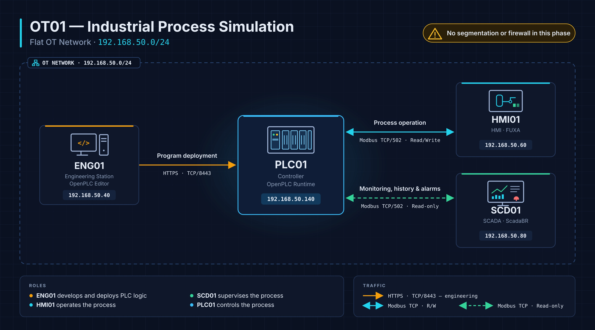

# OT01 — Simulación de un proceso industrial

> **OT-Labs · Laboratorio 01**  
> Implementación de un proceso industrial simulado con OpenPLC, FUXA y ScadaBR sobre una red OT plana.

## 1. Descripción general

OT01 — Industrial Process Simulation es el primer laboratorio del proyecto OT-Labs. Su objetivo es representar de forma simplificada un proceso industrial para comprender cómo funciona y cómo interactúan los distintos componentes de un entorno de tecnología operacional (OT).

El laboratorio simula el control del nivel de un depósito industrial, denominado TANK01, mediante un controlador lógico programable (PLC), una estación de ingeniería, una interfaz HMI y un sistema SCADA.

A través de este entorno se pretende comprender el funcionamiento básico de un proceso industrial, desde la programación de la lógica de control hasta la operación, supervisión y registro de las variables del proceso.

Además, OT01 establece la arquitectura inicial sobre la que se desarrollarán los siguientes laboratorios de OT-Labs, incorporando progresivamente segmentación de red, monitorización de seguridad y escenarios de ciberseguridad industrial.

### Objetivos

- Desarrollar y desplegar la lógica de control de TANK01.
- Comunicar aplicaciones industriales mediante **Modbus TCP**.
- Operar el proceso desde una interfaz **HMI**.
- Supervisar variables, consultar históricos y gestionar alarmas desde un **SCADA**.
- Validar el funcionamiento conjunto de las cuatro máquinas.

## 2. Arquitectura del laboratorio

Las cuatro máquinas comparten la red **`192.168.50.0/24`**, sin segmentación ni firewall intermedio.

| Máquina | Dirección IPv4 | Software principal | Función |
|---|---|---|---|
| **ENG01** | `192.168.50.40` | OpenPLC Editor | Desarrollo y despliegue del programa ST |
| **PLC01** | `192.168.50.140` | OpenPLC Runtime | Ejecución de la lógica de TANK01 y servidor Modbus TCP |
| **HMI01** | `192.168.50.60` | FUXA | Visualización y operación del proceso |
| **SCD01** | `192.168.50.80` | ScadaBR 1.2 | Supervisión, registro histórico y alarmas |

> **Nota:** el direccionamiento corresponde al laboratorio documentado. Puede adaptarse al entorno donde se reproduzca.

## 3. Comunicaciones

| Origen | Destino | Protocolo / puerto | Función |
|---|---|---|---|
| ENG01 | PLC01 | HTTPS / TCP `8443` | Conexión y despliegue del programa en OpenPLC Runtime |
| HMI01 | PLC01 | Modbus TCP / `502` | Lectura de variables y operaciones de control |
| SCD01 | PLC01 | Modbus TCP / `502` | Lectura de variables para supervisión e históricos |

**HMI01** dispone de funciones de lectura y escritura necesarias para operar TANK01. En cambio, los puntos Modbus de **SCD01** se configuran con la opción **Settable** desmarcada, para evitar escrituras desde ScadaBR. Esta configuración no sustituye controles de seguridad a nivel de red o del controlador.

## 4. Despliegue del laboratorio

Se recomienda seguir este orden:

1. **PLC01 — OpenPLC Runtime:** instalar el entorno de ejecución y habilitar las comunicaciones Modbus TCP.
2. **ENG01 — OpenPLC Editor:** crear el proyecto `TANK01-CONTROL`, implementar la lógica ST y desplegarla en PLC01.
3. **HMI01 — FUXA:** conectar con PLC01, configurar las variables Modbus y preparar la interfaz TANK01.
4. **SCD01 — ScadaBR:** configurar la fuente de datos Modbus, crear los puntos, activar el registro histórico y configurar los detectores de eventos.

Las instrucciones detalladas se encuentran en las guías individuales:

| Máquina | Guía en español | Guía en inglés |
|---|---|---|
| PLC01 | [PLC01 — OpenPLC Runtime](../../docs/es/machines/PLC01.md) | [PLC01 — OpenPLC Runtime](../../docs/en/machines/PLC01.md) |
| ENG01 | [ENG01 — OpenPLC Editor](../../docs/es/machines/ENG01.md) | [ENG01 — OpenPLC Editor](../../docs/en/machines/ENG01.md) |
| HMI01 | [HMI01 — FUXA](../../docs/es/machines/HMI01.md) | [HMI01 — FUXA](../../docs/en/machines/HMI01.md) |
| SCD01 | [SCD01 — ScadaBR](../../docs/es/machines/SCD01.md) | [SCD01 — ScadaBR](../../docs/en/machines/SCD01.md) |

## 5. Funcionamiento del proceso TANK01

El proceso **TANK01** simula el control del nivel de un depósito industrial mediante una bomba de llenado, una válvula de entrada y un mecanismo de vaciado.

Su funcionamiento está gestionado por el programa **TANK01-CONTROL**, ejecutado en PLC01 mediante OpenPLC Runtime. Desde HMI01 (FUXA), el operador puede seleccionar el modo de funcionamiento, controlar los elementos del proceso y supervisar la evolución del nivel.

El sistema dispone de dos modos de operación: **automático y manual**, además de una orden de parada que tiene prioridad sobre ambos.

### 5.1. Modo automático

Para utilizar el modo automático, el operador debe habilitar previamente la opción **AUTO** desde la interfaz HMI de FUXA.

Una vez habilitado, el PLC controla el llenado del depósito en función del nivel detectado, siguiendo estas condiciones:

1. Si el nivel del depósito es **inferior a 300**, el sistema activa automáticamente la bomba y la válvula de entrada para iniciar el llenado.
2. Mientras el nivel aumenta, la bomba y la válvula permanecen activadas.
3. Cuando el nivel **supera 800**, el PLC detiene el llenado.
4. Si el modo AUTO continúa habilitado, el sistema permanece a la espera hasta que el nivel vuelva a situarse por debajo de 300, momento en el que inicia un nuevo ciclo de llenado.

Si el modo AUTO no está habilitado, **el PLC no inicia el llenado automático, aunque el nivel sea inferior a 300**.

De esta manera, el operador decide cuándo habilitar el funcionamiento automático, mientras que el PLC se encarga de controlar los ciclos de llenado sin intervención continua.

### 5.2. Modo manual

En modo manual, el operador controla directamente los elementos del proceso desde la interfaz HMI de FUXA.

Para **llenar el depósito**, es necesario habilitar simultáneamente:

- **PUMP:** activa la bomba de llenado.
- **VALV:** habilita la válvula de entrada.

La activación de un único elemento no es suficiente para realizar el llenado; ambos deben estar habilitados.

Para **vaciar el depósito**, el operador utiliza el control **DOWN**, que permite disminuir el nivel del depósito sin necesidad de activar la bomba o la válvula de entrada.

Este modo permite observar individualmente el efecto de los distintos elementos sobre el proceso.

### 5.3. Parada del sistema

El proceso dispone de una orden **STOP**, cuya función es detener la operación independientemente del modo seleccionado.

Cuando el operador activa STOP:

- Se detiene el funcionamiento de la bomba.
- Se interrumpe el llenado mediante la válvula de entrada.
- Se detiene el vaciado del depósito.
- Las órdenes que estuvieran habilitadas quedan subordinadas a la condición de parada.

Por tanto, **STOP tiene prioridad sobre los modos automático y manual y sobre cualquier orden de operación activa**.

Esto permite comprender un principio fundamental del control industrial: la existencia de condiciones prioritarias que prevalecen sobre las órdenes normales del proceso.

### 5.4. Supervisión del nivel y alarmas

Durante el funcionamiento, el nivel del depósito se representa mediante la variable `LT01_LEVEL`, que puede visualizarse desde FUXA y ScadaBR.

El sistema también dispone de condiciones de alarma asociadas al nivel:

| Alarma | Condición | Descripción |
|---|---|---|
| `ALM_LOW` | Nivel ≤ 100 | Nivel bajo |
| `ALM_HIGH` | Nivel ≥ 900 | Nivel alto |
| `ALM_HH` | Nivel ≥ 950 | Nivel muy alto |

Estas alarmas permiten identificar condiciones del proceso fuera de su rango habitual de operación.

Desde **HMI01 (FUXA)** se visualiza y opera el proceso, mientras que **SCD01 (ScadaBR)** permite supervisar las variables, consultar su evolución histórica y registrar los eventos de alarma.

## 6. Continuación de OT-Labs

OT01 presenta un entorno OT funcional en una **red plana**. Esta configuración permite estudiar las comunicaciones y operaciones de referencia antes de introducir medidas adicionales de seguridad.

En **OT02** se ampliará la arquitectura con segmentación de red y controles de comunicación, utilizando OT01 como punto de partida para comparar ambos escenarios.

---

**OT-Labs · OT01 — Industrial Process Simulation**
