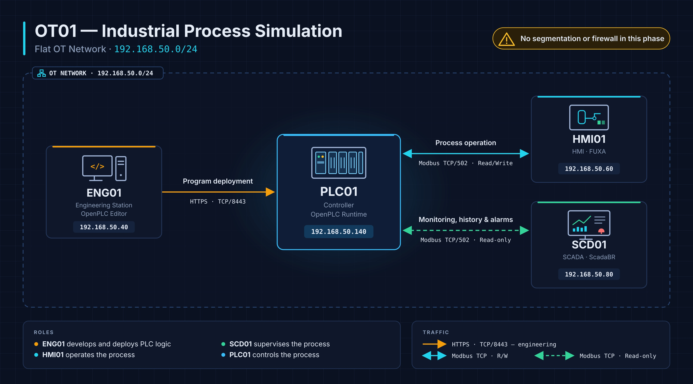

# OT01 — Industrial Process Simulation

> **OT-Labs · Lab 01**  
> Implementation of a simulated industrial process using OpenPLC, FUXA, and ScadaBR on a flat OT network.

## 1. Overview

OT01 — Industrial Process Simulation is the first lab in the OT-Labs project. Its purpose is to represent an industrial process in a simplified way to understand how it works and how the different components of an operational technology (OT) environment interact.

The lab simulates the level control of an industrial tank named TANK01 using a programmable logic controller (PLC), an engineering workstation, a human-machine interface (HMI), and a SCADA system.

This environment provides an introduction to how an industrial process operates, from developing the control logic to operating, monitoring, and recording process variables.

OT01 also establishes the initial architecture for subsequent OT-Labs labs, which will progressively introduce network segmentation, security monitoring, and industrial cybersecurity scenarios.

### Objectives

- Develop and deploy the TANK01 control logic.
- Connect industrial applications using **Modbus TCP**.
- Operate the process through an **HMI**.
- Monitor variables, view historical data, and manage alarms through a **SCADA** system.
- Validate the integrated operation of all four machines.

## 2. Lab Architecture

All four machines share the **`192.168.50.0/24`** network, with no segmentation or firewall between them.

| Machine | IPv4 Address | Main Software | Function |
|---|---|---|---|
| **ENG01** | `192.168.50.40` | OpenPLC Editor | Development and deployment of the ST program |
| **PLC01** | `192.168.50.140` | OpenPLC Runtime | Execution of TANK01 control logic and Modbus TCP server |
| **HMI01** | `192.168.50.60` | FUXA | Process visualization and operation |
| **SCD01** | `192.168.50.80` | ScadaBR 1.2 | Monitoring, historical data logging, and alarms |

> **Note:** The IP addressing shown corresponds to the documented lab. It can be adapted to the environment in which the lab is reproduced.

## 3. Communications

| Source | Destination | Protocol / Port | Function |
|---|---|---|---|
| ENG01 | PLC01 | HTTPS / TCP `8443` | Connection to OpenPLC Runtime and program deployment |
| HMI01 | PLC01 | Modbus TCP / `502` | Reading variables and performing control operations |
| SCD01 | PLC01 | Modbus TCP / `502` | Reading variables for monitoring and historical data logging |

**HMI01** provides the read and write functions required to operate TANK01. By contrast, the Modbus points in **SCD01** are configured with **Settable** unchecked to prevent writes from ScadaBR. This setting does not replace network-level or controller-level security controls.

## 4. Lab Deployment

The following deployment order is recommended:

1. **PLC01 — OpenPLC Runtime:** Install the runtime environment and enable Modbus TCP communications.
2. **ENG01 — OpenPLC Editor:** Create the `TANK01-CONTROL` project, implement the ST logic, and deploy it to PLC01.
3. **HMI01 — FUXA:** Connect to PLC01, configure the Modbus variables, and prepare the TANK01 interface.
4. **SCD01 — ScadaBR:** Configure the Modbus data source, create the points, enable historical data logging, and configure the event detectors.

Detailed instructions are available in the individual machine guides:

| Machine | Spanish Guide | English Guide |
|---|---|---|
| PLC01 | [PLC01 — OpenPLC Runtime](../../docs/es/machines/PLC01.md) | [PLC01 — OpenPLC Runtime](../../docs/en/machines/PLC01.md) |
| ENG01 | [ENG01 — OpenPLC Editor](../../docs/es/machines/ENG01.md) | [ENG01 — OpenPLC Editor](../../docs/en/machines/ENG01.md) |
| HMI01 | [HMI01 — FUXA](../../docs/es/machines/HMI01.md) | [HMI01 — FUXA](../../docs/en/machines/HMI01.md) |
| SCD01 | [SCD01 — ScadaBR](../../docs/es/machines/SCD01.md) | [SCD01 — ScadaBR](../../docs/en/machines/SCD01.md) |

## 5. TANK01 Process Operation

The **TANK01** process simulates level control in an industrial tank using a filling pump, an inlet valve, and a draining mechanism.

Its operation is managed by the **TANK01-CONTROL** program, which runs on PLC01 through OpenPLC Runtime. From HMI01 (FUXA), the operator can select the operating mode, control process components, and monitor changes in the tank level.

The system has two operating modes, **automatic and manual**, as well as a stop command that takes priority over both.

### 5.1. Automatic Mode

To use automatic mode, the operator must first enable the **AUTO** option from the FUXA HMI.

Once enabled, the PLC controls tank filling based on the measured level, according to the following conditions:

1. If the tank level is **below 300**, the system automatically activates the pump and inlet valve to start filling.
2. As the level rises, the pump and valve remain active.
3. When the level **exceeds 800**, the PLC stops filling.
4. If AUTO mode remains enabled, the system waits until the level falls below 300 again, at which point a new filling cycle begins.

If AUTO mode is not enabled, **the PLC will not start automatic filling, even if the level is below 300**.

In this way, the operator decides when to enable automatic operation, while the PLC manages filling cycles without continuous intervention.

### 5.2. Manual Mode

In manual mode, the operator directly controls the process components from the FUXA HMI.

To **fill the tank**, both of the following controls must be enabled:

- **PUMP:** Activates the filling pump.
- **VALV:** Enables the inlet valve.

Activating only one component is not sufficient to fill the tank; both must be enabled.

To **drain the tank**, the operator uses the **DOWN** control, which reduces the tank level without requiring the pump or inlet valve to be activated.

This mode makes it possible to observe the individual effects of the different components on the process.

### 5.3. System Stop

The process includes a **STOP** command that stops operation regardless of the selected mode.

When the operator activates STOP:

- The pump stops running.
- Filling through the inlet valve is interrupted.
- Tank draining stops.
- Any enabled commands are overridden by the stop condition.

Therefore, **STOP takes priority over both automatic and manual modes, as well as any active operating command**.

This illustrates a fundamental principle of industrial control: priority conditions can override normal process commands.

### 5.4. Level Monitoring and Alarms

During operation, the tank level is represented by the `LT01_LEVEL` variable, which can be viewed in FUXA and ScadaBR.

The system also includes alarm conditions associated with the tank level:

| Alarm | Condition | Description |
|---|---|---|
| `ALM_LOW` | Level ≤ 100 | Low level |
| `ALM_HIGH` | Level ≥ 900 | High level |
| `ALM_HH` | Level ≥ 950 | Very high level |

These alarms identify process conditions outside the normal operating range.

**HMI01 (FUXA)** is used to visualize and operate the process, while **SCD01 (ScadaBR)** is used to monitor variables, view their historical trends, and log alarm events.

## 6. Next Steps in OT-Labs

OT01 provides a functional OT environment on a **flat network**. This setup makes it possible to study baseline communications and operations before introducing additional security measures.

In **OT02**, the architecture will be expanded with network segmentation and communication controls, using OT01 as the starting point for comparing the two scenarios.

---

**OT-Labs · OT01 — Industrial Process Simulation**
